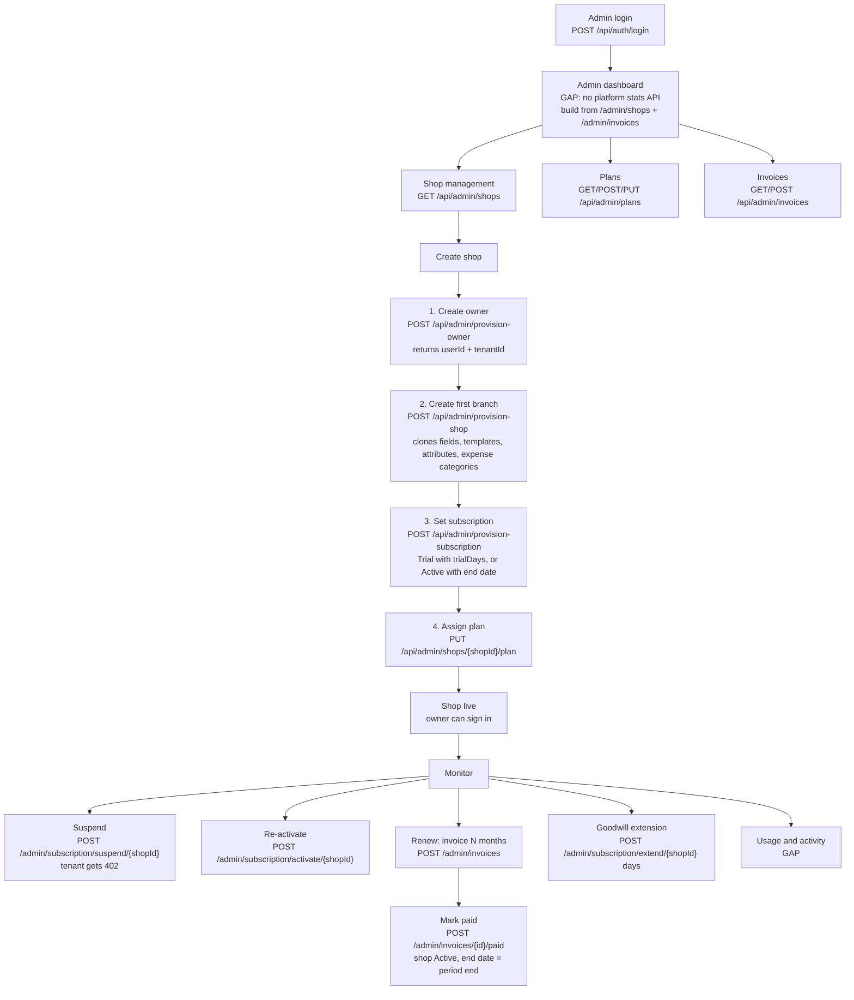
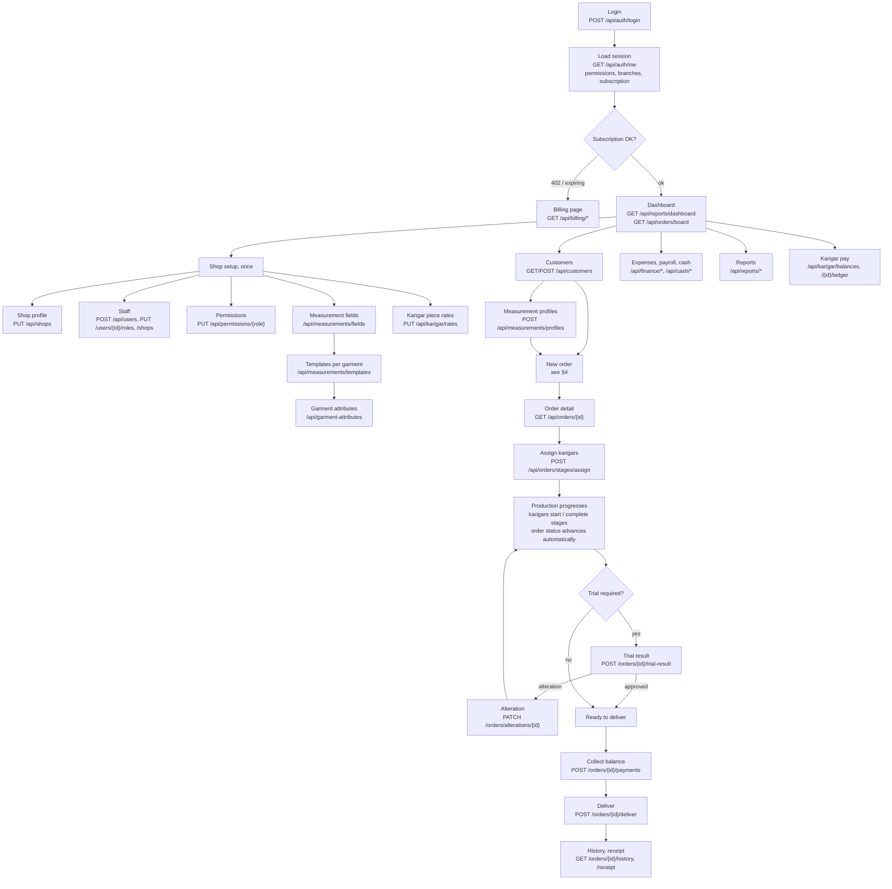
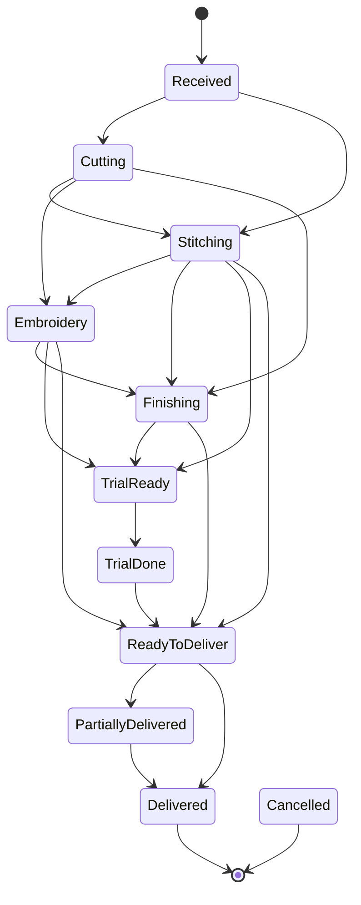
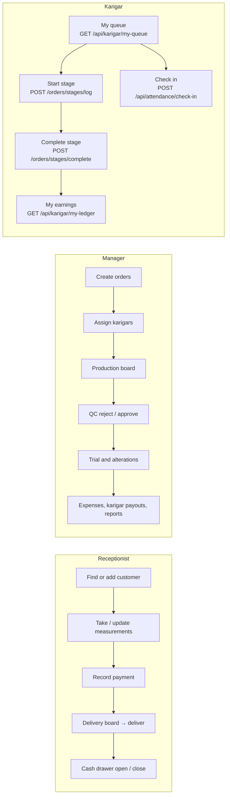
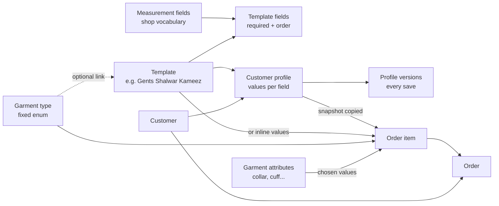
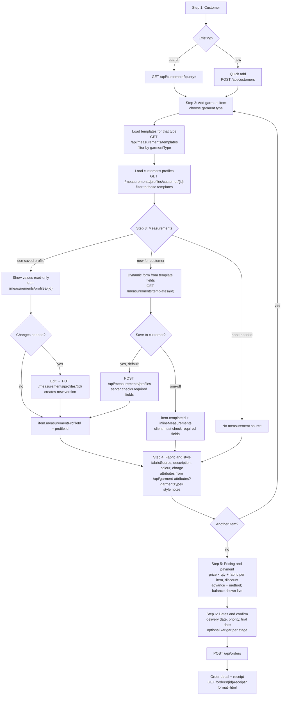
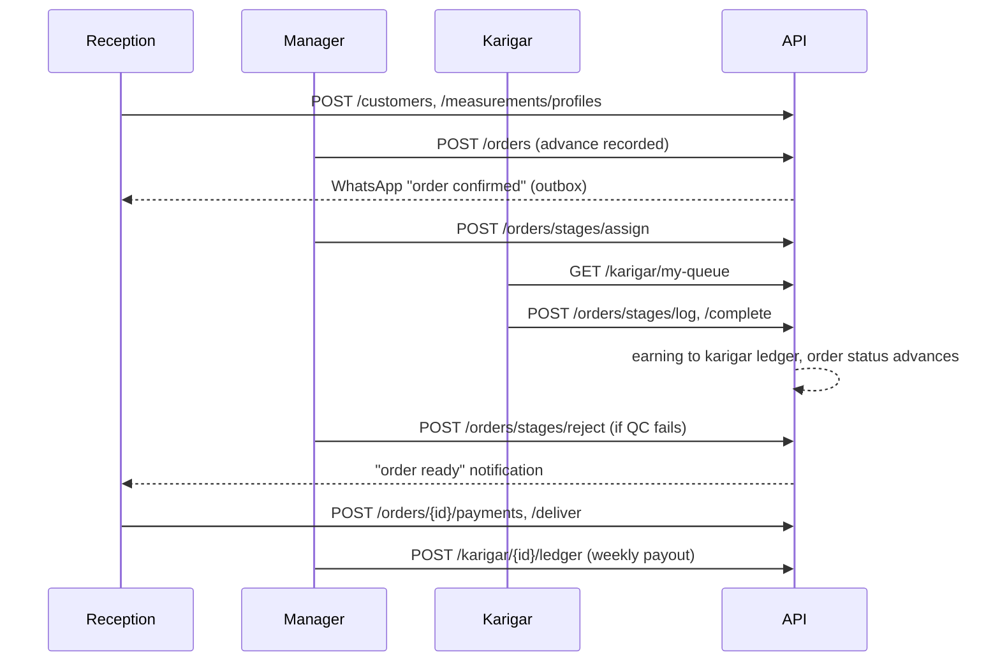

# Digital Darzi — Business Workflows

Phases 2 and 3: how the platform admin, the shop owner and shop staff work, mapped to the API
that exists today. Every endpoint named here is real; anything the backend cannot do is marked
**GAP** and listed in [API_MAPPING.md §3](API_MAPPING.md#3-missing-or-insufficient-apis).

Companions: [SYSTEM_ANALYSIS.md](SYSTEM_ANALYSIS.md), [ROLE_PERMISSIONS.md](ROLE_PERMISSIONS.md).

---

## 1. Super Admin workflow

What happens behind each step:

| Step | Server behaviour |
|---|---|
| Provision owner | Creates the Identity account (email + password or phone + PIN), a domain user with role Owner, and a new tenant id. Rejects duplicate email or phone. |
| Provision shop | Creates the branch under that tenant, links it to the owner's `ShopIds`, and seeds the tenant's measurement catalogue, seven templates, garment attributes and expense categories. |
| Provision subscription | Sets `Status`, `TrialEndsAt` (from `trialDays`) or `SubscriptionEndsAt`, and plan name/id on the shop. |
| Assign plan | Links a plan. Its `MaxBranches`, `MaxUsers`, `MaxOrdersPerMonth` are enforced when the tenant creates branches, users or orders. |
| Suspend / cancel / expiry | `SubscriptionMiddleware` returns 402 on every tenant route for that tenant. The owner can still sign in and open billing. |
| Extend | Pushes `SubscriptionEndsAt` (or trial end) forward by N days. |
| Invoices | Admin creates an invoice for N months (`POST /api/admin/invoices` with `shopId`, `months`, optional `amount`). The period starts at the current subscription end, or today if already expired, so renewals chain. Marking it paid (`POST /admin/invoices/{id}/paid` with method and reference) **sets the shop Active and moves `SubscriptionEndsAt` to the invoice period end**. This is the normal renewal path; extend-by-days is for goodwill or corrections. |

Not supported today: **GAP** platform statistics, **GAP** per-tenant usage and activity,
**GAP** platform settings, **GAP** plan-based feature flags, **GAP** editing a tenant's shop
profile from the admin side, **GAP** subscription status and plan in the admin shop list
(the list returns name, city, phone, active flag, created date only).

---

## 2. Shop Owner workflow

### Order lifecycle (enforced by the server)

Forward moves only. Also allowed, with a mandatory note because they go backwards:
Stitching → Cutting, Embroidery → Stitching, Finishing → Stitching, TrialDone → Stitching or
Finishing, ReadyToDeliver → Stitching or Finishing. **Cancelled** is reachable from every state
except PartiallyDelivered and Delivered.

The authoritative list for any order is
`allowedNextStatuses` on `GET /api/orders/{id}`. Backward moves need a note; supervisors can
force any move from a non-terminal state with a note. Payment state (`Unpaid`, `Partial`, `Paid`,
`Refunded`) is separate and never changes production status.

---

## 3. Staff workflows

Staff is not one role. The backend has three staff roles with different defaults.

| Task | Owner | Manager | Receptionist | Karigar |
|---|---|---|---|---|
| View customers | yes | yes | yes | no |
| Create orders | yes | yes | **no by default** | no |
| Update measurements | yes | yes | yes | no |
| Update order status | yes | yes | no | indirectly, by completing stages |
| Stitching progress | yes | yes, all karigars | no | own assignments only |
| Deliveries | yes | yes | yes, not with balance owed | no |
| View / record payments | yes | yes | record yes, refund no | no |
| Change staff permissions | yes | no | no | no |

Full matrix in [ROLE_PERMISSIONS.md](ROLE_PERMISSIONS.md).

---

## 4. Measurement and order creation

### 4.1 How the pieces relate

- A **garment type** says what is being made. It is fixed in code.
- A **template** says which measurements are taken for it. Several templates may share a garment
  type (Gents vs Ladies). Owners manage templates.
- A **profile** holds one customer's values for one template, with full version history.
- An **order item** carries a frozen **snapshot** of the measurements used, so later profile edits
  never change a past order.

### 4.2 New order flow

Rules the UI must follow:

1. Show only the fields of the chosen template, in template order, marking required fields.
2. Show only profiles whose template matches the item's garment type. The current app does not
   do this.
3. Default to **saving new measurements to the customer**. Inline one-off values are for
   exceptional cases, because the server does not keep them on the customer or validate them.
4. Multiple garments per order are fully supported (up to 50 items). Each item has its own
   measurement source.
5. Totals are computed by the server; the client preview must use the same formula:
   `subTotal = Σ(price × qty + fabricCharge)`, `grandTotal = subTotal − discount`, advance becomes
   the first payment.
6. Stage assignment at creation is optional; most shops assign from the order detail later.

---

## 5. Daily operations at a glance

---

## 6. Decisions that need your approval

| # | Decision | Options | Recommendation |
|---|---|---|---|
| D1 | **Where is the frontend code**, and which framework | — | Needed before any UI work. |
| D2 | **Target platform** | Mobile app as in the screenshots, web SaaS with sidebar as in the brief, or both | Web for Owner/Manager/Admin, mobile for Karigar and reception. Same API. |
| D3 | **Owner-managed garment types** | (a) Keep the fixed list and let templates be the owner's "order types". (b) Backend change to a per-shop garment type table. | (a) now. It meets the need with zero backend risk; (b) is a multi-day migration touching rates, attributes and reports. |
| D4 | **Master / Cutter / Helper** designations | (a) Drop and use Karigar. (b) Add a display-only designation field to users. | (b), a small backend change, permissions stay on roles. |
| D5 | **Save measurements entered during an order** | (a) Always save as customer profile. (b) Ask each time. (c) Never. | (a) with an "one-off, don't save" option. |
| D6 | **Receptionist creating orders** | Keep default (cannot) or grant `orders.create` | Grant, if counter staff take orders. Owner can do this today without code. |
| D7 | **Karigar sees order prices** | Allow as today, or restrict (backend change) | Restrict in the UI now by using only `my-queue`; decide on backend trimming later. |
| D8 | **Super Admin console** | Separate app, or a separate area of the same app | Separate area of the same web app, routed by role after sign-in. |
| D9 | **Backend gaps** in API_MAPPING §3 | Build them in this API, or design the UI around their absence | Build the small ones (admin shop list with subscription, admin stats, template deactivate, field label/default, designation). Defer feature flags and garment-type table. |
