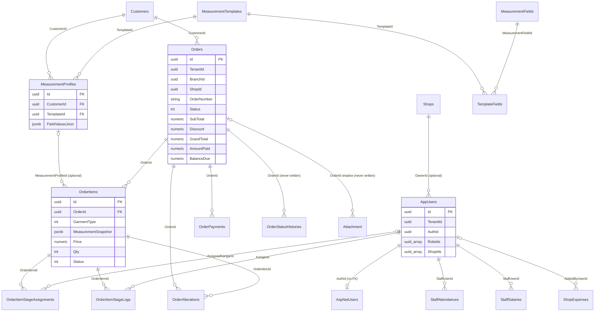

# Digital Darzi API — Database Design (as implemented)

This document describes the database **as it exists in the code today**, not an intended design. Every statement was checked against the entity classes, `ApplicationDbContext`, the EF model snapshot and the services. Where something could not be confirmed it is marked *not confirmed*. Section 11 is the only forward-looking part and is labelled PROPOSED.

Companion document: [CODEBASE_AUDIT.md](CODEBASE_AUDIT.md) (priorities and roadmap).

---

## 1. Overview

| Item | Value | Source |
|---|---|---|
| Runtime | .NET 8 (`net8.0`) | `*.csproj` |
| ORM | EF Core 8 — `Microsoft.EntityFrameworkCore.Design` 8.0.0, snapshot `ProductVersion` 8.0.4 | [ApplicationDbContextModelSnapshot.cs:21](../Infrastructure/Migrations/ApplicationDbContextModelSnapshot.cs#L21) |
| Provider | `Npgsql.EntityFrameworkCore.PostgreSQL` 8.0.4 (PostgreSQL) | `Infrastructure.csproj` |
| Identity | `Microsoft.AspNetCore.Identity.EntityFrameworkCore` 8.0.0; `ApplicationDbContext : IdentityDbContext<ApplicationUser, IdentityRole<Guid>, Guid>` | [ApplicationDbContext.cs:9](../Infrastructure/Data/ApplicationDbContext.cs#L9) |
| Key generation | `Guid` PKs generated client-side (`Guid.NewGuid()` in `BaseDBModel`); `UseIdentityByDefaultColumns` applies to the Identity `int` keys | [BaseDBModel.cs](../Domain/Entities/BaseDBModel.cs) |
| Migrations | `20260614084902_InitialCreate`, `20260617172629_AddShopSubscription` | `Infrastructure/Migrations/` |
| Startup | `MigrateAsync()` then `DbInitializer.SeedAsync()` on every boot, using a context constructed with `Guid.Empty/Guid.Empty` | [Program.cs:157-166](../API/Program.cs#L157) |

`AddShopSubscription` does three things: adds `Status`, `TrialEndsAt`, `SubscriptionEndsAt`, `SubscriptionPlanName` to `Shops`; promotes `TemplateFields` and `OrderStatusHistories` from lightweight bases to full `BaseDBModel` columns (`ActiveStatus`, `ClientId`, `IsDeleted`, `Sr`, `UpdatedBy`, `UpdatedOn`, plus `BranchId` on `OrderStatusHistories`); and creates the `Attachment` table (see §2 defect b).

Physical types: every `decimal` is unbounded `numeric` (16 columns, no precision/scale); every `DateTime` is `timestamp with time zone` (51 columns, including calendar-only values such as `StaffAttendance.Date` and `Customer.DateOfBirth`); `TimeSpan` → `interval` (`CheckIn`/`CheckOut`); `List<Guid>` → `uuid[]`; two `jsonb` columns. Incoming JSON dates are normalised to UTC by `API/Json/UtcDateTimeConverter` [Program.cs:113-116](../API/Program.cs#L113).

---

## 2. Multi-tenant strategy

**Model:** single database, single schema, row-level isolation. Every domain row carries `TenantId` and `BranchId` (from `BaseDBModel`); most operational tables also carry a `ShopId`. By convention `BranchId == Shop.Id` — set at provisioning ([AdminProvisioningService.cs:165](../Infrastructure/Services/AdminProvisioningService.cs#L165)).

**Per-request context:** `ApplicationDbContext` is registered `Scoped` with a factory that reads the `tenantId` and `shopId` JWT claims and passes them to the constructor; missing/invalid claims fall back to `Guid.Empty` [Program.cs:20-31](../API/Program.cs#L20). The context captures them as `_tenantId`/`_shopId` [ApplicationDbContext.cs:14-19](../Infrastructure/Data/ApplicationDbContext.cs#L14).

**Global query filters** [ApplicationDbContext.cs:46-65](../Infrastructure/Data/ApplicationDbContext.cs#L46):

| Scope | Entities | Filter |
|---|---|---|
| Tenant only | `Shop`, `User` | `TenantId == _tenantId && !IsDeleted` |
| Tenant + branch, soft-delete | `Customer`, `MeasurementField`, `MeasurementTemplate`, `MeasurementProfile`, `Order`, `OrderItem`, `OrderAlteration`, `StaffAttendance`, `ShopExpense`, `StaffSalary` | `TenantId == _tenantId && BranchId == _shopId && !IsDeleted` |
| Tenant + branch, **no** soft-delete term | `TemplateField`, `OrderItemStageAssignment`, `OrderItemStageLog`, `OrderPayment`, `OrderStatusHistory` | `TenantId == _tenantId && BranchId == _shopId` |
| Not filtered | `AspNetUsers`, `AspNetRoles`, `AspNetUserRoles`, `AspNetUserClaims`, `AspNetRoleClaims`, `AspNetUserLogins`, `AspNetUserTokens`, `Attachment` | — |

`BaseRepository` adds `!IsDeleted` to every read on top of the filter [BaseRepository.cs:26-38](../Infrastructure/Repositories/BaseRepository.cs#L26). Cross-tenant admin code uses `IgnoreQueryFilters()` (AdminProvisioningService, TenantSetupService, DbInitializer, AuthService).

**Known defects (factual):**

a. **Filters use `BranchId`, indexes use `ShopId`.** Every composite index in §6 is on `(TenantId, ShopId, …)`; no index contains `BranchId`, which is the column every filter actually predicates on. The two columns hold the same value and are both stored.
b. **`Attachment` is mapped but has no `DbSet`, no query filter and no repository.** The class lives in [OrderImage.cs](../Domain/Entities/OrderImage.cs) (file name ≠ class name). It reaches the model only through `Order.Attachments`, producing table `Attachment` (singular) with a nullable shadow FK `OrderId` alongside its own `EntityId` [ApplicationDbContextModelSnapshot.cs:26-83](../Infrastructure/Migrations/ApplicationDbContextModelSnapshot.cs#L26). `AttachmentService` is a placeholder that never touches the database.
c. **`OrderMeasurementSnapshot` is not mapped.** [OrderMeasurementSnapshot.cs](../Domain/Entities/OrderMeasurementSnapshot.cs) has no `DbSet`, no navigation from any mapped entity, and does not appear in the snapshot — it is dead code. There is no `OrderImage` class; the file of that name contains `Attachment`. The `ImmutableEntity` and `LightEntity` bases are likewise not used by any mapped entity.
d. **No `SaveChanges` override stamps `TenantId`/`BranchId`/audit columns.** Services set them by hand. The generic `ShopExpenseService.CreateAsync`, `StaffSalaryService.CreateAsync` and `StaffAttendanceService.CreateAsync` set `ShopId`, `CreatedBy`, `CreatedOn`, `ActiveStatus` but **not** `TenantId`/`BranchId` ([ShopExpenseService.cs:35-41](../Infrastructure/Services/ShopExpenseService.cs#L35), [StaffSalaryService.cs:35-41](../Infrastructure/Services/StaffSalaryService.cs#L35), [StaffAttendanceService.cs:141-144](../Infrastructure/Services/StaffAttendanceService.cs#L141)); rows written that way carry `Guid.Empty` and are invisible to the tenant filter. `ClientId` and `Sr` are never written by any code (`Sr` value generation: *not confirmed*, entity default is 0).
e. An unintended shadow FK `TemplateFields.MeasurementProfileId` (nullable, indexed) exists because EF discovered the computed property `MeasurementProfile.TemplateFields` as a navigation [ApplicationDbContextModelSnapshot.cs:1240](../Infrastructure/Migrations/ApplicationDbContextModelSnapshot.cs#L1240), [MeasurementProfile.cs:19](../Domain/Entities/MeasurementProfile.cs#L19).

---

## 3. Entity catalogue

Common columns on every `BaseDBModel` table: `Id uuid PK`, `TenantId`, `BranchId`, `ClientId`, `Sr bigint`, `IsDeleted`, `ActiveStatus int`, `CreatedBy`, `CreatedOn`, `UpdatedBy`, `UpdatedOn`. Only entity-specific columns are listed below.

### Shop / User

| Table | Columns | FKs / special | Written by code |
|---|---|---|---|
| `Shops` | `OwnerId uuid?`, `Name`, `Address`, `City`, `Phone`, `WhatsAppNumber`, `LogoUrl`, `Currency` (default "PKR"), `CurrencySymbol`, `Status int?` (`SubscriptionStatus`), `TrialEndsAt`, `SubscriptionEndsAt`, `SubscriptionPlanName` | `OwnerId → AppUsers` (optional, no delete behaviour set) | All set in provisioning / ShopService; `BranchId = Id` |
| `AppUsers` | `AuthId uuid?` (→ `AspNetUsers.Id`, **no FK constraint**), `Name`, `Email`, `Phone`, `Passcode` (BCrypt hash), `RoleIds uuid[]`, `ShopIds uuid[]`, `LastLoginDate`, `LoginCount` | `RoleIds`/`ShopIds` are Postgres arrays [ApplicationDbContext.cs:68-71](../Infrastructure/Data/ApplicationDbContext.cs#L68); no FK to `AspNetRoles`/`Shops` | Owner: `BranchId = Guid.Empty` until first shop is provisioned; `LastLoginDate`/`LoginCount` updated on login |

### Customer

| Table | Columns | FKs | Written by code |
|---|---|---|---|
| `Customers` | `ShopId`, `Name`, `Phone`, `Email`, `Address`, `City`, `Gender int`, `DateOfBirth timestamptz?`, `Notes`, `TotalOrders int`, `TotalSpend numeric`, `LoyaltyPoints int`, `LoyaltyTier text` (default "Bronze") | — | Denormalised totals incremented only in `OrderService.CreateAsync` (`TotalOrders++`, `TotalSpend += GrandTotal`, `+10` points, tier recalculated) [OrderService.cs:175-178](../Infrastructure/Services/OrderService.cs#L175); never decremented on cancel or adjusted on alteration/discount change |

### Measurement

| Table | Columns | FKs / special | Notes |
|---|---|---|---|
| `MeasurementFields` | `ShopId`, `Name`, `Unit int` (`MeasurementUnit`), `IsRequired`, `SortOrder` | — | `TenantId = Guid.Empty` marks the 18 system rows; service refuses edits to them |
| `MeasurementTemplates` | `ShopId`, `Name`, `Description`, `GarmentType int?`, `IsDefault`, `IsSystemTemplate`, `DisplayOrder` | — | System rows: `TenantId = Guid.Empty`, `IsSystemTemplate = true`; tenant clones have `IsSystemTemplate = false` |
| `TemplateFields` | `TemplateId`, `MeasurementFieldId`, `IsRequired`, `SortOrder`, `MeasurementProfileId uuid?` (shadow, defect e) | `TemplateId → MeasurementTemplates` cascade; `MeasurementFieldId → MeasurementFields` cascade | Junction table |
| `MeasurementProfiles` | `CustomerId`, `TemplateId`, `ProfileName`, `FieldValuesJson jsonb`, `Notes` | `CustomerId → Customers` cascade; `TemplateId → MeasurementTemplates` cascade | JSON is `Dictionary<Guid, decimal>` serialised with `System.Text.Json` [MeasurementService.cs:200](../Infrastructure/Services/MeasurementService.cs#L200) |

### Order

| Table | Columns | FKs / special | Written by code |
|---|---|---|---|
| `Orders` | `ShopId`, `OrderNumber`, `CustomerId`, `CreatedByUserId uuid?`, `Status int`, `Priority int`, `DeliveryDate`, `ActualDeliveryDate?`, `Notes`, `SpecialInstructions`, `SubTotal`, `Discount`, `GrandTotal`, `AmountPaid`, `BalanceDue`, `CancellationReason`, `CancellationStage int?`, `RefundAmount`, `RefundStatus int?` | `CustomerId → Customers` cascade | **Never set:** `Priority` (stays `Normal`), `CreatedByUserId` (no FK either), `ActualDeliveryDate`, `CancellationReason`, `CancellationStage`, `RefundAmount`, `RefundStatus` |
| `OrderItems` | `OrderId`, `GarmentType int`, `MeasurementProfileId uuid?`, `MeasurementSnapshot jsonb`, `FabricDescription`, `FabricColor`, `StyleNotes`, `Price`, `Qty`, `Status int` (`OrderItemStatus`), `IsDelivered`, `DeliveredOn?`, `Notes` | `OrderId → Orders` cascade; `MeasurementProfileId → MeasurementProfiles` optional | Only `Status = InProgress` is written (on first stage log) [OrderService.cs:361](../Infrastructure/Services/OrderService.cs#L361); `Done`, `IsDelivered`, `DeliveredOn` never set |
| `OrderItemStageAssignments` | `OrderItemId`, `Stage int` (`ProductionStage`), `AssignedKarigarId uuid?`, `StagePrice numeric?`, `EstimatedDays`, `Notes` | `OrderItemId → OrderItems` cascade; `AssignedKarigarId → AppUsers` restrict | Written at order create and `AssignStageAsync` (upsert per stage) |
| `OrderItemStageLogs` | `OrderItemId`, `Stage int`, `KarigarId`, `Notes`, `CompletedAt?` | `OrderItemId → OrderItems` cascade; `KarigarId → AppUsers` restrict, required | Insert in `RecordStageLogAsync`; `CompletedAt` set in `CompleteStageAsync` |
| `OrderPayments` | `OrderId`, `Amount`, `PaymentMethod int`, `Note`, `PaidAt` | `OrderId → Orders` cascade | Advance at create; `RecordPaymentAsync` |
| `OrderAlterations` | `OrderId`, `OrderItemId`, `Description`, `AdditionalCharge`, `DeliveryDate?`, `Notes` | both FKs cascade | Insert only; **no status column** (`AlterationStatus` enum unused) |
| `OrderStatusHistories` | `OrderId`, `OrderItemId?`, `ChangedBy` (no FK), `FromStatus`, `ToStatus`, `IsReversal`, `AssignedFrom?`, `AssignedTo?`, `ChangedOn`, `Notes` | `OrderId → Orders` cascade (no collection on `Order`) | **Never written** — the only references are the `DbSet`, filter and index |
| `Attachment` | `EntityId uuid?`, `AttachmentType int`, `ImageUrl`, `Description`, `OrderId uuid?` (shadow) | `OrderId → Orders` (no delete behaviour set) | Never written (defect b) |

### Staff and expenses

| Table | Columns | FKs | Notes |
|---|---|---|---|
| `StaffAttendances` | `ShopId`, `StaffUserId`, `Date timestamptz`, `Status int` (`AttendanceStatus`), `CheckIn interval?`, `CheckOut interval?`, `Notes` | `StaffUserId → AppUsers` restrict | Check-in path stamps tenant/branch; generic `CreateAsync` does not (defect d) |
| `StaffSalaries` | `ShopId`, `StaffUserId`, `Month int`, `Year int`, `BaseSalary`, `Bonus`, `Deduction`, `NetSalary`, `PaymentMethod int`, `Notes`, `PaidOn` | `StaffUserId → AppUsers` restrict | `NetSalary` recomputed on update only; no status column (`SalaryStatus` unused) |
| `ShopExpenses` | `ShopId`, `Category text` (free string), `Description`, `Amount`, `ExpenseDate`, `PaymentMethod int`, `ReceiptRef`, `AddedByUserId uuid?` | `AddedByUserId → AppUsers` restrict | `ExpenseCategory` enum unused |

---

## 4. Entity relationship diagram



`Shops`, `Customers`, `MeasurementFields/Templates`, `StaffAttendances`, `StaffSalaries`, `ShopExpenses` and `Orders` all carry a `ShopId` column, but **no FK to `Shops` is declared** on any of them.

---

## 5. Enums

All enums live in [Enums.cs](../Domain/Enums/Enums.cs). "Used" = referenced anywhere outside `Enums.cs` and `Migrations/` (verified by grep).

| Enum | Values | Used |
|---|---|---|
| `ActiveStatus` | Inactive=0, Active=1 | Yes (`BaseDBModel.ActiveStatus`) |
| `MeasurementUnit` | Inch=1, CM=2, MM=3 | Yes |
| `Gender` | Male=1, Female=2, Other=3 | Yes |
| `GarmentType` | ShalwarKameez=1, Suit=2, Sherwani=3, Coat=4, Trouser=5, Shirt=6, Frock=7, Lehnga=8, Kurta=9, Waistcoat=10, Other=99 | Yes |
| `OrderStatus` | Pending=0, Received=1, Cutting=2, Stitching=3, Embroidery=4, Finishing=5, TrialReady=6, TrialDone=7, ReadyToDeliver=8, PartiallyDelivered=9, Delivered=10, Cancelled=11, FullyPaid=12 | Yes |
| `OrderPriority` | Normal=1, Rush=2, VIP=3 | Column only — never assigned |
| `PaymentMethod` | Cash=1, JazzCash=2, EasyPaisa=3, BankTransfer=4, Other=5 | Yes |
| `FabricStatus` | Sufficient=1, Short=2, Excess=3 | **Unused** |
| `CancellationStage` | BeforeCutting=1, AfterCutting=2, AfterStitching=3 | Column only — never assigned |
| `RefundStatus` | Pending=1, Processed=2, Waived=3 | Column only — never assigned |
| `AlterationStatus` | Received=1, InProgress=2, Done=3 | **Unused** (no column) |
| `StageAssignmentMode` | PrePlanned=1, AdHoc=2 | **Unused** |
| `ExpenseCategory` | Rent=1, Salary=2, Utilities=3, Materials=4, Equipment=5, Other=9 | **Unused** (`ShopExpense.Category` is a free string) |
| `SalaryStatus` | Pending=1, PartiallyPaid=2, Paid=3 | **Unused** |
| `AttachmentType` | Order=1 | Yes (stub service only) |
| `ProductionStage` | Cutting=1, Stitching=2, Embroidery=3, Ironing=4, Finishing=5, QualityCheck=6 | Yes |
| `OrderItemStatus` | Pending=0, InProgress=1, Done=2, Delivered=3, Cancelled=4 | Yes (only `InProgress` written) |
| `AttendanceStatus` | Present=1, Absent=2, HalfDay=3, Leave=4, Holiday=5 | Yes |
| `SubscriptionStatus` | Trial=1, Active=2, Suspended=3, Cancelled=4 | Yes |

Note `OrderStatus.FullyPaid` (12) is a payment state stored in the same column as production state; `RecordPaymentAsync` overwrites whatever production status the order had when the balance reaches zero.

---

## 6. Indexes and constraints

Explicit `HasIndex` configuration [ApplicationDbContext.cs:80-138](../Infrastructure/Data/ApplicationDbContext.cs#L80). EF additionally creates a single-column index for every FK (e.g. `Orders.CustomerId`, `OrderItems.OrderId`, `TemplateFields.MeasurementProfileId`).

| Table | Columns | Unique |
|---|---|---|
| Customers | TenantId, ShopId, Phone | **Yes** |
| MeasurementFields | TenantId, ShopId, Name | **Yes** |
| TemplateFields | TemplateId, MeasurementFieldId | **Yes** |
| Orders | TenantId, ShopId, OrderNumber | **Yes** |
| Orders | TenantId, CustomerId, Status | No |
| Orders | TenantId, ShopId, DeliveryDate | No |
| OrderItems | TenantId, OrderId | No |
| OrderItemStageAssignments | OrderItemId, Stage | **Yes** |
| OrderItemStageAssignments | TenantId, AssignedKarigarId, Stage | No |
| OrderItemStageLogs | TenantId, OrderItemId | No |
| OrderItemStageLogs | TenantId, KarigarId, Stage | No |
| OrderAlterations | TenantId, OrderItemId | No |
| OrderPayments | TenantId, OrderId | No |
| OrderStatusHistories | TenantId, OrderId | No |
| StaffAttendances | TenantId, StaffUserId, Date | **Yes** |
| ShopExpenses | TenantId, ShopId, ExpenseDate | No |
| ShopExpenses | TenantId, ShopId, Category | No |
| StaffSalaries | TenantId, StaffUserId, Month, Year | **Yes** |
| StaffSalaries | TenantId, ShopId, Year, Month | No |

**Unique business keys:** customer phone per shop; measurement field name per shop; field per template; order number per shop; one assignment per stage per order item; one attendance row per staff per `Date` (a `timestamptz`, so equality depends on the caller normalising to midnight UTC); one salary row per staff per month/year.

Unique indexes are **not** filtered on `IsDeleted`, so a soft-deleted customer still blocks re-use of its phone number. No CHECK constraints exist (e.g. `Amount > 0`, `Month BETWEEN 1 AND 12`) — validation is service-side only. `OrderNumber` is generated as `ORD-yyMMdd-<6 hex chars of a GUID>` with no retry on collision [OrderService.cs:463](../Infrastructure/Services/OrderService.cs#L463).

---

## 7. Transaction boundaries and concurrency

`UnitOfWork` wraps `Database.BeginTransactionAsync`, refuses nesting, and `CommitAsync` calls `SaveChanges` then commits [UnitOfWork.cs:21-53](../Infrastructure/Data/UnitOfWork.cs#L21). It is injected only into `OrderService`. `BaseRepository.AddAsync`, `UpdateAsync` and `DeleteAsync` each call `SaveChangesAsync` themselves [BaseRepository.cs:78-101](../Infrastructure/Repositories/BaseRepository.cs#L78), so any multi-repository flow that does not open an explicit transaction commits piecemeal. Because the context is scoped, `UnitOfWork`, every repository and `TenantSetupService` share the same `DbContext` instance within a request, which is what makes the two explicit transactions below cover the nested repository saves.

| Flow | Explicit transaction | Notes |
|---|---|---|
| Order create | Yes — `_uow.BeginTransactionAsync` [OrderService.cs:62](../Infrastructure/Services/OrderService.cs#L62) | Order graph + customer totals committed together; attachments after commit (stub) |
| Shop provisioning | Yes — `_db.Database.BeginTransactionAsync` [AdminProvisioningService.cs:139](../Infrastructure/Services/AdminProvisioningService.cs#L139) | Shop + owner update + `TenantSetupService` clone in one transaction |
| Owner provisioning | **No** | `UserManager.CreateAsync` (AspNetUsers) then `AppUsers` insert — orphaned Identity user if the second step fails [AdminProvisioningService.cs:82-113](../Infrastructure/Services/AdminProvisioningService.cs#L82) |
| Staff user create | **No** | Same Identity-then-domain pattern [UserService.cs:144-183](../Infrastructure/Services/UserService.cs#L144) |
| Record payment | No explicit transaction, but a single `SaveChanges` inserts the payment and updates the order atomically [OrderRepository.cs:164-168](../Repositories/Implementations/OrderRepository.cs#L164) | |
| Add alteration / stage log / stage assign | Same single-`SaveChanges` pattern | |
| Cancel order | Single update of `Status` only | No refund, history or item-status changes |
| Seed (`DbInitializer`) | **No** | Roles, Identity admin, domain user, shop and tenant clone in separate saves |

**Concurrency:** no `BaseDBModel` entity has a concurrency token; the only `IsConcurrencyToken` columns are Identity's `ConcurrencyStamp` on `AspNetUsers`/`AspNetRoles`. `Order.AmountPaid`/`BalanceDue` are read, mutated in memory and written back (`+=`/`-=`) [OrderService.cs:261-263](../Infrastructure/Services/OrderService.cs#L261); two concurrent payments can both pass the `Amount > BalanceDue` check and overpay. `Customer.TotalSpend`/`LoyaltyPoints` have the same pattern.

---

## 8. Measurement architecture

```
MeasurementTemplate ──< TemplateField >── MeasurementField
        │                                        (Name, Unit)
        └──< MeasurementProfile (per customer)
                  FieldValuesJson jsonb: { "<fieldId>": 38.5, ... }
                             │
                             ▼ copied at order time
              OrderItem.MeasurementSnapshot jsonb (same shape, or "{}")
```

- Templates define which fields apply (with per-template `IsRequired`/`SortOrder` overrides). A profile stores values keyed by `MeasurementField.Id` as `Dictionary<Guid, decimal>`.
- On order create the profile's JSON is deserialised and re-serialised into `OrderItem.MeasurementSnapshot`; inline measurements (no profile) are stored the same way; no measurements → `"{}"` [OrderService.cs:88-114](../Infrastructure/Services/OrderService.cs#L88).
- **System templates**: 18 fields and 7 templates are seeded with `TenantId = BranchId = ShopId = Guid.Empty`. `TenantSetupService.SetupNewTenantAsync` deep-copies them into each new tenant/shop with fresh IDs, remapping field IDs [TenantSetupService.cs:23-110](../Infrastructure/Services/TenantSetupService.cs#L23). Consequently a tenant's "Chest" has a different `Id` from every other tenant's.

**Limitations (as implemented):** no versioning or history of profile edits (`UpdateProfileAsync` overwrites `FieldValuesJson` in place); values are `decimal` only — no text/enum values (e.g. "loose fit"); the snapshot holds field IDs and numbers only — no field names, units or template name, so rendering an old order depends on the field rows still existing; `MeasurementProfile.UpdatedOn` is declared with `new` and hides the base property (one column results, but the override is redundant); the `OrderMeasurementSnapshot` entity that was designed to hold a richer snapshot is unmapped.

---

## 9. Order architecture

**Money columns** (`numeric`, unbounded):

| Column | Computed |
|---|---|
| `OrderItem.Price`, `Qty` | From request |
| `Order.SubTotal` | `Σ Price × Qty` at create; **not** recomputed on alteration |
| `Order.Discount` | From request; editable via `UpdateAsync` |
| `Order.GrandTotal` | `SubTotal − Discount`; `+= AdditionalCharge` on alteration |
| `Order.AmountPaid` | `= AdvancePayment` at create; `+= Amount` per payment |
| `Order.BalanceDue` | `GrandTotal − AmountPaid`; `−= Amount` per payment; `+= AdditionalCharge` per alteration |
| `Order.RefundAmount` | Never set |

Payments are also stored as `OrderPayments` rows, so `AmountPaid` is a denormalised total. `UpdateAsync` recomputes `GrandTotal`/`BalanceDue` from `SubTotal` when the discount changes, which silently drops any alteration charges previously folded into `GrandTotal` [OrderService.cs:210-215](../Infrastructure/Services/OrderService.cs#L210).

**Status:** `Order.Status` (`OrderStatus`) is set to `Pending` at create, to any value via `UpdateStatusAsync` (no transition validation, no history row) [OrderRepository.cs:155-162](../Repositories/Implementations/OrderRepository.cs#L155), to `FullyPaid` when balance hits zero, `Cancelled` by `CancelOrderAsync`, `Delivered` by `MarkDeliveredAsync`. Order status is **not derived** from item stage progress.

**Stage model:** `OrderItemStageAssignment` is the plan (one row per stage per item, with karigar and `StagePrice`); `OrderItemStageLog` is the work record (insert on start, `CompletedAt` on completion). Karigar earnings in reports are `Σ StagePrice` of assignments — there is no payout table, so nothing records what has actually been paid.

**Missing:** status history (table exists, never written), a state machine, per-item delivery (`IsDelivered`/`DeliveredOn` never set), cancellation details/refunds (columns exist, never set), priority (never set), alteration lifecycle.

---

## 10. Seed data

`DbInitializer.SeedAsync` runs at every startup [DbInitializer.cs:22](../Infrastructure/Data/DbInitializer.cs#L22):

1. **Roles** (idempotent): `SystemAdmin`, `Owner`, `Manager`, `Karigar`, `Receptionist`.
2. **System measurement catalogue** (if no `MeasurementFields` with `TenantId = Guid.Empty`): 18 fields (Chest, Waist, Hip, Shoulder, Sleeve, Kameez Length, Shirt Length, Collar, Trouser Length, Pant Length, Inseam, Pauncha, Coat Length, Cuff, Back Width, Neck Depth, Bust, Frock Length — all `Inch`) and 7 templates (Gents Shalwar Kameez [default], Gents Pant Coat, Sherwani, Ladies Shalwar Kameez, Ladies Frock, Shirt Only, Trouser Only).
3. **System admin** (if `AspNetUsers` is empty): Identity user `admin@digitaldarzi.com` with a **hard-coded password literal in source** [DbInitializer.cs:58](../Infrastructure/Data/DbInitializer.cs#L58), role `SystemAdmin`; a domain `AppUsers` row and a `Shops` row named "Digital Darzi HQ" under a freshly generated tenant/shop GUID pair; then `SetupNewTenantAsync` clones the catalogue into that HQ tenant.

---

## 11. PROPOSED schema changes (not implemented)

Brief list; see the roadmap document for sequencing.

- **Indexes on `BranchId`**: either add `BranchId` to every composite index or drop `ShopId` from operational tables and index the column the filters use.
- **`SaveChanges` override** to stamp `TenantId`, `BranchId`, `CreatedBy/On`, `UpdatedBy/On` from `ICurrentUserService`, removing the hand-stamping and fixing defect d.
- **Optimistic concurrency** via Npgsql `xmin` (`UseXminAsConcurrencyToken`) on `Orders`, `Customers`, `StaffSalaries`.
- **`DateOnly`** for `StaffAttendance.Date`, `Customer.DateOfBirth`, `ShopExpense.ExpenseDate`, `Order.DeliveryDate` (maps to Postgres `date`).
- **`AuditLog` table** (or start writing `OrderStatusHistories`) for status transitions and reassignments.
- **`KarigarRate` / `KarigarPayout`** tables so earnings are a ledger rather than `Σ StagePrice`.
- **`OrderAlteration.Status`** column using the existing `AlterationStatus` enum.
- **`RefreshTokens` table** — `AuthService.RefreshAsync` currently returns "not yet implemented" and the issued refresh token is random bytes stored nowhere [AuthService.cs:82-83](../Infrastructure/Services/AuthService.cs#L82).
- **Notification outbox** table for WhatsApp/SMS delivery with retry.
- Housekeeping: map or delete `OrderMeasurementSnapshot` and `Attachment`; remove the computed `MeasurementProfile.TemplateFields` property to drop the shadow FK; add FKs from `ShopId` columns to `Shops`; filtered unique indexes (`WHERE "IsDeleted" = false`).
