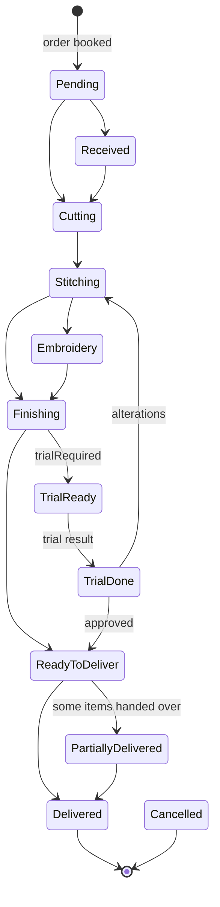

# Digital Darzi — Mobile App Integration Guide

For the developer building the mobile app (Flutter, React Native or native — nothing here is
framework-specific). Read sections 1–5 before writing any code. Sections 6–8 are the order
workflow, which is the heart of the product. Section 12 lists every endpoint.

Everything here was checked against the running API and its source code on 2026-09-28.
Swagger (dev only): `http://localhost:5294/swagger`.

## API status (tested 2026-09-28)

All 187 endpoints were called against the running API, following the real workflow
(customer → measurements → order → stages → trial → payment → delivery, plus cash, inventory,
finance, attendance, users, reports, files).

| Result | Count |
|---|---|
| Working | 166 |
| Correctly rejected (wrong reset code) | 1 |
| **Broken** | **2** |
| Not tested (SystemAdmin-only `/api/admin/*` + shop subscription — admin password not available) | 18 |

Broken — being fixed on the backend; don't build on these yet:

1. `GET /api/shops` (list branches) returns 500. **Mobile doesn't need it** — use `branches`
   from `GET /api/auth/me`. `GET /api/shops/{id}` works.
2. `PUT /api/measurements/templates/{id}` with a `fields` list returns 409. Renaming works.
   Template editing is a back-office task; the mobile app only reads templates.

Every endpoint the mobile app needs (sections 4–9) works. The one flow not proven end to end is
**password/PIN reset with a real code** — the code goes out by SMS/email, so only the
"wrong code" path was tested.

---

## 1. What the system does

Digital Darzi runs a tailoring shop. A **customer** is measured, an **order** is booked with
one or more **garments** (items), each garment goes through **production stages** (cutting,
stitching, embroidery, …) done by **karigars** (tailors), may go through a **trial fitting**
and **alterations**, is **paid for** (advance + balance) and finally **delivered**.

One owner (a *tenant*) can have several **branches** (shops). Every signed-in request works on
exactly one branch — the one in the access token. Data never crosses tenants.

### Who uses the app

| Role | Signs in with | Uses the app for |
|---|---|---|
| **Owner** | email + password | Everything, all branches, reports, money |
| **Manager** | email + password | Running the shop; most Owner rights except user admin |
| **Receptionist** | email + password | Counter: customers, measurements, taking payments, handing over. By default **cannot** book or edit orders, change status, or record alterations — the owner can grant `orders.create` etc. |
| **Karigar** | phone + 4–6 digit PIN | Own work queue: start / finish stages, own earnings, attendance |

Permissions are **customisable per shop owner**, so never decide what to show from the role
name — use the `permissions` list from `GET /api/auth/me` (section 4.4).

Suggested app split: one app with two home screens — a **Karigar home** (queue) for users who
have `production.work` but not `orders.list`, and a **Shop home** for everyone else.

---

## 2. Environments and base URL

| Where the app runs | Base URL for the local dev API |
|---|---|
| Android emulator | `http://10.0.2.2:5294` |
| iOS simulator | `http://localhost:5294` |
| Physical phone on the same Wi-Fi | `http://<PC-LAN-IP>:5294` — start the API with `dotnet run --project API --urls http://0.0.0.0:5294` and allow port 5294 through the Windows firewall |

- All routes start with `/api/`.
- Plain HTTP is only for development. Android blocks cleartext by default — allow it for the
  dev host only (`network_security_config`), iOS needs an ATS exception for the dev host.
  Production is HTTPS only.
- CORS does not apply to mobile apps.

### Demo accounts (seeded dev database)

| Role | Credentials |
|---|---|
| Owner (2 branches) | `ali@shop.test` / `Owner!2026` |
| Receptionist | `sana@shop.test` / `Recep!2026` |
| Karigar | phone `03009998888`, PIN `1234` |

---

## 3. Conventions — read before writing the HTTP layer

### 3.1 Every response is an envelope

```json
{ "success": true, "data": { ... }, "message": "Order created.", "errors": [] }
```

```json
{ "success": false, "data": null, "message": "Validation failed", "errors": ["Qty must be at least 1"] }
```

Write **one** HTTP helper that returns `data` on success and throws an error object carrying
`status`, `message` and `errors` otherwise. Show `errors[0]` (or `message`) to the user — the
texts are written for shop staff.

**Exception 1 — permission and login-state rejections have an empty body.** A 401 (no/expired
token) or 403 (missing permission) raised by the framework comes back with **no body at all**,
not the envelope. 403s raised by the business logic (e.g. "This work was started by another
karigar") do have the envelope. Your helper must not crash on an empty body — fall back to a
default message per status code.

**Exception 2** — if the JSON body is malformed or a field has the wrong type (e.g. a string where a
number is expected), ASP.NET answers **400 with a ProblemDetails body** instead of the envelope:
`{ "title": "One or more validation errors occurred.", "errors": { "items[0].qty": ["..."] } }`.
Your helper should handle both shapes. You will only see this while developing.

### 3.2 HTTP status codes

| Status | Meaning | What the app does |
|---|---|---|
| 200 / 201 | Success (`201` for creates) | Use `data` |
| 400 | Business rule or validation failure | Show the message; don't retry |
| 401 | Access token missing/expired, or wrong login | Refresh once (4.2), then send to login |
| 402 | Shop subscription suspended/expired, **or** plan limit reached (e.g. orders per month) | Show the message; read-only mode |
| 403 | Signed in but lacks the permission | Show the message; hide the action next time |
| 404 | Record not found in this branch (also: `GET /api/cash/current` when no cash session is open — treat as "no session") | Show "not found", go back |
| 409 | Conflict (e.g. stage already in progress, duplicate phone) | Re-fetch the record and show the message |
| 422 | Operation not valid in the current state | Show the message, re-fetch |
| 423 | Account locked after 5 wrong logins (15 minutes) | Show the message; offer "forgot PIN/password" |
| 429 | Too many sign-in attempts (20/min) | Ask the user to wait a minute |
| 500 | Server bug | Generic error; log it |

### 3.3 Enums are integers

`"status": 8` not `"status": "ReadyToDeliver"`. All values are in section 11. Keep a label map
in the app. One exception: the customer ledger (`GET /api/customers/{id}/ledger`) returns
`orders[].status` as text (`"Pending"`). `stageProgress[].status` is also text by design.

### 3.3a What a create/update returns

Not uniform — check per endpoint:

| Returns | Endpoints |
|---|---|
| 201 + the new **id** as a bare string | customers, attendance, expenses, salaries, shops (`POST`); several `PUT`s return the id too |
| 201 + the **full order** | `POST /api/orders`, `POST /api/orders/{id}/reorder` |
| 200 + the full object | order actions (status, payment, deliver, cancel, trial), measurement profiles, alterations, inventory |
| 200 + `data: null` | stage assign / log / complete / reject, logout, change PIN — re-fetch afterwards |

Lists come in three forms: `PagedResult`, the older `PaginatedResultModel` (3.7) and plain arrays
(e.g. `due-today`, `overdue`, `customer/{id}` orders, templates, fields).

### 3.4 IDs

All IDs are GUID strings: `"813e9dfb-9dc3-47d6-a4d3-e236d60792c3"`. The empty GUID
`00000000-0000-0000-0000-000000000000` means "not set / me" where a field is required but
optional in meaning (see stage start, 7.3).

### 3.5 Dates — two kinds, handle them differently

| Kind | Fields | Send | Display |
|---|---|---|---|
| **Instant** (a moment in time) | `createdOn`, `paidAt`, `changedOn`, `startedAt`, `completedAt`, `expiresAt`… | ISO-8601 UTC with `Z` | Convert to the phone's local time |
| **Calendar date** (a day, no time) | `deliveryDate`, `trialDate`, `expenseDate`, alteration `deliveryDate`, `readyDate`, report `date` | The picked day as `"2026-10-15T00:00:00Z"` | Format **in UTC** — never convert to local time |

Calendar dates are stored as midnight UTC of the shop's local day. If you convert
`2026-10-15T00:00:00Z` to local time on a phone west of UTC it shows **14 Oct** — wrong.
In Dart: `DateTime.parse(s).toUtc()` then format; in JS: `Intl.DateTimeFormat(..., { timeZone: 'UTC' })`.

Query-string dates (`from`, `to`, `dateFrom`…) must also be full ISO with `Z`:
`?from=2026-09-01T00:00:00Z&to=2026-09-30T23:59:59Z`.

The shop's time zone (default `Asia/Karachi`) decides what "today", "overdue" and "due tomorrow"
mean. The server computes those — don't recompute them on the phone.

### 3.6 Money

Plain JSON numbers (decimals). Show them with `currencySymbol` from `/api/auth/me` (e.g. `₨`).
Don't compute totals yourself for anything you save — the server calculates `subTotal`,
`grandTotal`, `balanceDue` and returns them. Computing a preview total on the form is fine.

### 3.7 Paging — two shapes

Most lists (orders, users, finance, inventory, admin):

```json
{ "items": [...], "totalCount": 42, "page": 1, "pageSize": 20, "totalPages": 3, "hasNextPage": true, "hasPreviousPage": false }
```
Query: `page`, `pageSize`.

Older generic lists (`/api/customers`, `/api/shops`, `/api/expenses`, `/api/salaries`, `/api/attendance`):

```json
{ "data": [...], "pageNumber": 1, "pageSize": 10, "totalRecords": 42 }
```
Query: `pageNumber`, `pageSize` (plus `query`/`keyword` filters). Has-more = `pageNumber * pageSize < totalRecords`.

### 3.8 Retries and double-submits

The API has **no idempotency keys**. If a `POST` (payment, order, delivery) times out, the
server may already have saved it. So:

- Retry `GET` automatically; **never auto-retry** `POST/PUT/PATCH/DELETE`.
- Disable the submit button while a write is in flight.
- After a write times out, re-fetch the record (e.g. the order) and check before letting the
  user try again — otherwise you can record the same payment twice.

---

## 4. Authentication

### 4.1 Sign in

`POST /api/auth/login` — public, rate limited (20 per minute per IP).

```json
{ "email": "ali@shop.test", "password": "Owner!2026" }
```
or, for karigars:
```json
{ "phone": "03009998888", "passcode": "1234" }
```

The phone must match **exactly** how it was registered (`03009998888`, not `+923009998888`).

Response `data`:

```json
{
  "accessToken": "eyJhbGciOi...",
  "refreshToken": "q3Jc...base64...",
  "expiresAt": "2026-09-29T11:52:14Z",
  "refreshTokenExpiresAt": "2026-10-28T11:52:14Z",
  "userName": "Ali Tailor",
  "roles": ["Owner"],
  "userId": "…", "tenantId": "…", "shopId": "…"
}
```

- **Access token**: JWT, send as `Authorization: Bearer <accessToken>` on every call. Lives
  24 hours (`expiresAt`).
- **Refresh token**: opaque string, lives 30 days. Store both in secure storage
  (Keychain / Android Keystore — `flutter_secure_storage`, `react-native-keychain`,
  `expo-secure-store`). Never in plain shared preferences / AsyncStorage.
- Wrong credentials → 401 `"Invalid credentials."`. Five wrong attempts → 423 for 15 minutes.

### 4.2 Refresh — rotation with reuse detection

`POST /api/auth/refresh` with `{ "refreshToken": "<stored refresh token>" }` → a **new**
access token **and a new refresh token**. The old refresh token is dead from that moment.

**If an old (already used) refresh token is ever sent again, the server assumes it was stolen
and signs the user out on every device** — even the newest refresh token stops working
("Refresh token was already used. Please sign in again."). Access tokens already issued keep
working until they expire, so the app only notices at its next refresh. This makes the refresh logic in the app critical:

1. On a 401 from any authenticated call, run **one** refresh — if several requests fail at the
   same time they must all wait for the **same** refresh (a shared in-flight promise/future/lock).
   Two parallel refreshes with the same token = reuse = user logged out everywhere.
2. Save the new token pair **before** retrying anything.
3. Retry the original request once with the new access token.
4. If refresh fails (401), clear storage and go to the login screen.

Also refresh proactively on app resume if `expiresAt` is less than ~5 minutes away.

Pseudo-code:

```text
refreshInFlight = null
async request(req):
  res = send(req with Bearer access)
  if res.status == 401 and req.authenticated and not req.isRetry:
      refreshInFlight ??= doRefresh().finally(() => refreshInFlight = null)
      if await refreshInFlight: return request(req as retry)
      signOutLocally(); goTo(login)
  return res
```

### 4.3 Sign out

`POST /api/auth/logout` with `{ "refreshToken": "<current>", "allDevices": false }` revokes that
session (`allDevices: true` ends all sessions). Clear local storage even if the call fails.

### 4.4 Who am I — `GET /api/auth/me`

Call right after login, on app start, and after switching branch. Not rate limited. Cache it.

```json
{
  "userId": "…", "name": "Ali Tailor", "email": "ali@shop.test", "phone": null,
  "tenantId": "…", "shopId": "…", "shopName": "Ali Darzi Karachi",
  "currency": "PKR", "currencySymbol": "₨",
  "roles": ["Owner"],
  "permissions": ["orders.view", "orders.list", "orders.create", "..."],
  "branches": [ { "id": "…", "name": "Ali Darzi Karachi", "city": "Karachi" },
                { "id": "…", "name": "Ali Darzi Lahore",  "city": "Lahore" } ],
  "subscription": { "status": 1, "trialEndsAt": "2026-10-12T11:52:14Z", "subscriptionEndsAt": null, "planName": null }
}
```

- Gate every screen and button with `permissions.includes("...")` (list in section 5).
  The server enforces the same checks — hiding is for UX, not security.
- `subscription.status`: 1 Trial, 2 Active, 3 Suspended, 4 Cancelled. Show a banner for trial
  end dates; a 402 on any call means the shop is blocked.

### 4.5 Switch branch

Only if `branches.length > 1`. `POST /api/auth/switch-branch` `{ "shopId": "<branch id>" }`
returns a new token pair (same shape as login). Save it, **clear every cached list/record**
(they belong to the old branch), then reload `/me`.

### 4.6 Forgot / change credentials

| Flow | Calls |
|---|---|
| Forgot password / PIN | `POST /api/auth/forgot-password` `{ "email": "…" }` or `{ "phone": "…" }` → always says "if an account exists, a code was sent" (6-digit code by SMS for phone, email for email). Then `POST /api/auth/reset-password` `{ "phone": "…", "code": "123456", "newPin": "4321" }` (or `email` + `newPassword`). Success signs the user out everywhere. |
| Change PIN (karigar) | `POST /api/auth/change-pin` `{ "currentPin": "1234", "newPin": "4321" }` |
| Change password | `POST /api/auth/change-password` `{ "currentPassword": "…", "newPassword": "…" }` |

Note: the sign-in rate limit is per IP address. Phones on mobile data often share one public
IP (carrier NAT), so many users signing in at once from the same network can hit 429. Keep
login attempts to one per tap and show the 429 message.

---

## 5. Permissions → screens

| Permission | Unlocks |
|---|---|
| `orders.list` | Order list, search, delivery board, due-today, overdue |
| `orders.view` | Order detail, history, receipt |
| `orders.create` | New order, re-order |
| `orders.edit` | Edit order (date, notes, discount), delete attachments |
| `orders.status` | Change order status manually |
| `orders.cancel` | Cancel order |
| `orders.deliver` | Deliver (hand over) |
| `orders.deliver_with_balance` | Hand over while money is still due |
| `payments.record` / `payments.refund` | Take payment / refund |
| `alterations.manage` | Alterations, trial result |
| `production.assign` | Assign karigars to stages, workflow board |
| `production.work` | Karigar: start / finish own stages |
| `production.qc` | Reject finished work (quality check) |
| `customers.view` / `customers.edit` / `customers.delete` | Customers |
| `measurements.view` / `measurements.edit` / `measurements.configure` | See / save customer measurements / configure fields & templates |
| `finance.view` / `finance.manage` / `finance.delete` | Expenses, salaries, attendance admin, customer ledger |
| `reports.view` / `reports.tenant_wide` | Dashboard & reports / all-branch reports |
| `karigar.view_all` / `karigar.payouts` | Other karigars' queues & rates / karigar ledger & payouts |
| `inventory.view` / `inventory.manage` | Stock |
| `cash.manage` | Cash drawer (open/close day) |
| `users.view` / `users.edit` / `users.manage` | Staff |
| `shops.edit` / `shops.manage` | Branch settings / create branches |
| `notifications.manage`, `audit.view`, `settings.permissions`, `billing.view` | Admin screens |

Default karigar permissions: `orders.view`, `production.work`, `measurements.view`.
Default receptionist: `orders.view`, `orders.list`, `orders.deliver`, `payments.record`,
`customers.view`, `customers.edit`, `measurements.view`, `measurements.edit`, `inventory.view`,
`cash.manage`.

---

## 6. The order workflow

### 6.1 Lifecycle



(Also allowed: skipping Received/Cutting, going back one step with a note, and **Cancelled from
any status except PartiallyDelivered, Delivered, Cancelled**.)

| Status | Value | Allowed next |
|---|---|---|
| Pending | 0 | Received, Cutting, Stitching, Cancelled |
| Received | 1 | Cutting, Stitching, Cancelled |
| Cutting | 2 | Stitching, Embroidery, Finishing, Cancelled |
| Stitching | 3 | Embroidery, Finishing, TrialReady, ReadyToDeliver, Cutting*, Cancelled |
| Embroidery | 4 | Stitching*, Finishing, TrialReady, ReadyToDeliver, Cancelled |
| Finishing | 5 | TrialReady, ReadyToDeliver, Stitching*, Cancelled |
| TrialReady | 6 | TrialDone, Cancelled |
| TrialDone | 7 | Stitching*, Finishing*, ReadyToDeliver, Cancelled |
| ReadyToDeliver | 8 | PartiallyDelivered, Delivered, Stitching*, Finishing*, Cancelled |
| PartiallyDelivered | 9 | Delivered |
| Delivered | 10 | — (final) |
| Cancelled | 11 | — (final) |

`*` = backwards move, needs `notes`. **Don't hard-code this table** — every order detail
response has `allowedNextStatuses`; build the "change status" menu from it.

Payment is tracked separately in `paymentStatus` (0 Unpaid, 1 Partial, 2 Paid, 3 Refunded).
An order can be `ReadyToDeliver` and `Partial` at the same time.

### 6.2 Most status changes happen automatically

Staff rarely need the manual status menu:

| Event | Automatic effect |
|---|---|
| A karigar **starts** a stage | Order moves forward to that stage's status (Cutting → Cutting, Stitching → Stitching, Embroidery → Embroidery, Ironing/Finishing/QualityCheck → Finishing). Never moves backwards. |
| **All planned stages of all items** are completed | Order → `TrialReady` (if `trialRequired`) else `ReadyToDeliver`; customer is notified |
| Trial result **approved** | `TrialDone` → `ReadyToDeliver` |
| Trial result **alterations** | `TrialDone`, alteration records created |
| QC **rejects** finished work | Stage reopened as rework; order moves back to that stage |
| **Deliver** all remaining items | `Delivered` (or `PartiallyDelivered` if only some) |

After any write, re-fetch the order (`GET /api/orders/{id}`) — the response of most order
actions already **is** the fresh order detail.

---

## 7. Screen recipes

### 7.1 Customer: find or create

```text
GET  /api/customers?query=0300&pageNumber=1&pageSize=20     (name or phone search)
POST /api/customers
```
```json
{ "name": "Ahmed Khan", "phone": "03001234567", "gender": 1, "customerType": 1,
  "city": "Karachi", "notificationsOptOut": false }
```
→ `data` is the new customer **id** (string). Duplicate phone in the branch → 409.

Customer detail: `GET /api/customers/{id}`; their orders: `GET /api/orders/customer/{customerId}`;
balance statement (needs `finance.view`): `GET /api/customers/{id}/ledger`.

### 7.2 Measurements

A **field** is one measurement (Chest, Waist, Sleeve…). A **template** is the set of fields for
a garment type. A **profile** is one customer's values for one template. Profiles are
versioned; orders keep a **snapshot**, so later edits never change a booked order.

```text
GET  /api/measurements/templates                  → pick the template for the garment type
GET  /api/measurements/templates/{id}             → its fields (id, name, unit, isRequired, sortOrder)
GET  /api/measurements/profiles/customer/{customerId}   → existing profiles
POST /api/measurements/profiles                   → create
PUT  /api/measurements/profiles/{id}              → update (creates a new version)
GET  /api/measurements/profiles/{id}/versions     → history
```
```json
{ "customerId": "…", "templateId": "…", "profileName": "Kameez – Eid 2026",
  "values": { "<fieldId>": 38.5, "<fieldId>": 16 },
  "textValues": { "<fieldId>": "loose fit" }, "notes": "" }
```
Keys of `values` / `textValues` are **field ids**. Units: 1 Inch, 2 CM, 3 MM.

Garment options (collar type, cuff style…) come from `GET /api/garment-attributes?garmentType=1`.
They go into an order item's `attributes` map keyed by the attribute **name**
(`{ "Collar": "Round" }`, case-insensitive). The server rejects a value that is not in the
attribute's option list and an order missing an attribute marked required — build these as
pickers from that endpoint.

### 7.3 Book an order

`POST /api/orders` (`orders.create`)

```json
{
  "customerId": "…",
  "deliveryDate": "2026-10-10T00:00:00Z",
  "priority": 1,
  "discount": 0,
  "advancePayment": 1000,
  "paymentMethod": 1,
  "trialRequired": false,
  "trialDate": null,
  "notes": "Eid order",
  "specialInstructions": null,
  "items": [
    {
      "garmentType": 1,
      "qty": 1,
      "price": 3500,
      "fabricSource": 1,
      "fabricCharge": 0,
      "fabricDescription": "white wash & wear",
      "fabricColor": "white",
      "styleNotes": "round collar",
      "attributes": { "Collar": "Round" },
      "measurementProfileId": "…",
      "stageAssignments": [
        { "stage": 1, "assignedKarigarId": "…", "estimatedDays": 1 },
        { "stage": 2, "assignedKarigarId": "…", "estimatedDays": 3 }
      ]
    }
  ]
}
```

- Measurements per item: `measurementProfileId` (a saved profile of **this** customer), or
  `templateId` + `inlineMeasurements` `{fieldId: number}` for one-off values, or none.
- `stageAssignments` is optional — the shop can assign later with `/stages/assign`.
  `stagePrice` is optional; when left out the karigar's rate card price is used.
- Server rules: at least one item; discount ≤ subtotal; `advancePayment` ≤ total.
  Line total = `price × qty + fabricCharge`.
- Response: **201** with the full order detail (use `data.id`, `data.orderNumber`).
- The customer gets an "order confirmed" WhatsApp/SMS automatically (unless opted out).

Re-order a previous order: `POST /api/orders/{id}/reorder` `{ "deliveryDate": "…", "useLatestMeasurements": true }`.

### 7.4 Order detail screen

`GET /api/orders/{id}` returns everything for one screen: totals, `status`,
`paymentStatus`, `allowedNextStatuses`, `items[]` (with `measurements[]` and
`stageProgress[]`), `payments[]`, `alterations[]`, `history[]`.

Actions (show each only with its permission):

| Button | Call |
|---|---|
| Take payment | `POST /api/orders/{id}/payments` `{ "amount": 2500, "paymentMethod": 1, "note": null }` — amount must be > 0 and ≤ `balanceDue` |
| Refund | `POST /api/orders/{id}/refunds` `{ "amount": 500, "paymentMethod": 1, "note": "…" }` |
| Change status | `PATCH /api/orders/{id}/status` `{ "status": 8, "notes": "…" }` — Owner/Manager may add `"force": true` with a note to jump anywhere |
| Deliver all | `POST /api/orders/{id}/deliver` `{ }` |
| Deliver some items | `POST /api/orders/{id}/deliver` `{ "itemIds": ["…"] }` |
| Deliver with money still due | `{ "allowBalance": true, "notes": "will pay Friday" }` — needs `orders.deliver_with_balance`; note required |
| Cancel | `POST /api/orders/{id}/cancel` `{ "reason": "…", "refundAmount": 1000, "refundMethod": 1, "waiveRefund": false }` |
| Trial result | `POST /api/orders/{id}/trial-result` `{ "outcome": 1 }` (approved) or `{ "outcome": 2, "alterations": [{ "orderItemId": "…", "description": "Shorten sleeves 1 inch", "additionalCharge": 0 }] }` — only when status is TrialReady (or TrialDone) |
| Add alteration | `POST /api/orders/alterations` `{ "orderItemId": "…", "description": "…", "additionalCharge": 300, "deliveryDate": "2026-10-12T00:00:00Z", "assignedKarigarId": "…" }` |
| Update alteration | `PATCH /api/orders/alterations/{alterationId}` `{ "status": 3 }` (1 Received, 2 InProgress, 3 Done, 4 Delivered, 5 Cancelled) |
| Receipt | `GET /api/orders/{id}/receipt` → JSON (render natively / print on a Bluetooth printer), or `?format=html` for a printable page |
| Photos | section 9 |

Delivering the whole order while `balanceDue > 0` without `allowBalance` fails with a message
telling staff to take payment first — show a "Take payment" shortcut.

### 7.5 Karigar app

```text
GET  /api/karigar/my-queue            → pendingTasks[], inProgressTasks[], alterationTasks[], counters
POST /api/orders/stages/log           → START a task
POST /api/orders/stages/complete      → FINISH a task
GET  /api/karigar/my-completed?from=…&to=…   → finished work history
GET  /api/karigar/my-ledger?from=…&to=…      → earnings, advances, deductions, balance
POST /api/attendance/check-in         → mark present today (call again to set check-out)
GET  /api/attendance/my-attendance?month=9&year=2026
```

Attendance `checkIn` / `checkOut` are `"HH:mm:ss"` strings in the **shop's local time**, not
instants — show them as-is.

Start (the karigar is the caller, so send the empty GUID):

```json
{ "orderItemId": "…", "stage": 2, "karigarId": "00000000-0000-0000-0000-000000000000", "notes": null }
```

Finish:

```json
{ "orderItemId": "…", "stage": 2, "notes": null, "recutRequired": false }
```
For cutting, the optional `fabricUsed`, `cutQuantity`, `defectNotes` can be sent;
`"recutRequired": true` reopens cutting as rework instead of finishing it.

Rules the server enforces (show its message on 403/409):

- A karigar can only start stages **assigned to them** (or unassigned ones) and only record
  their own work.
- Only the karigar who started a task can finish it (Owner/Manager can finish anyone's).
- Starting a stage that is already running → 409; finishing a stage already finished → 400.
- "Start" is optional — finishing directly works and is common in small shops.
- Finishing adds the stage price to the karigar's earnings ledger automatically (rework is not
  paid twice).

Each task in the queue has `isOverdue`, `isUrgent`, `isRework` + `reworkReason`,
`orderDeliveryDate`, `garmentType`, `stage`, `qty`, `attributes`, `styleNotes`, `fabricColor`.
Tasks in `pendingTasks` show **Start**, tasks in `inProgressTasks` show **Done**. Refresh the
queue on pull-to-refresh, on app resume and after every action.

### 7.6 Shop floor (supervisor)

```text
GET  /api/workflow/board?stage=2&perColumn=20   → items per stage column (production.assign)
POST /api/orders/stages/assign   { "orderItemId": "…", "stage": 2, "assignedKarigarId": "…", "estimatedDays": 2 }
POST /api/orders/stages/reject   { "orderItemId": "…", "stage": 2, "reason": "Uneven hem", "deductAmount": 0 }   (production.qc)
GET  /api/karigar/{karigarId}/queue     → any karigar's queue (karigar.view_all)
GET  /api/karigar/performance
```

### 7.7 Counter / delivery

```text
GET /api/orders/board?perBucket=20   → overdue, dueToday, dueTomorrow, readyForPickup, deliveredToday (+ counts)
GET /api/orders?query=ORD-26&status=8&hasBalance=true&page=1&pageSize=20
GET /api/orders/due-today
GET /api/orders/overdue
```
Order search filters: `query` (order no., customer name or phone), `status`, `paymentStatus`,
`priority`, `customerId`, `karigarId`, `garmentType`, `dateFrom`/`dateTo` (booked),
`deliveryFrom`/`deliveryTo`, `dueToday`, `overdue`, `hasBalance`,
`sortBy` (`createdOn` | `deliveryDate` | `grandTotal` | `balanceDue` | `orderNumber`),
`sortDirection` (`asc` | `desc`), `page`, `pageSize`.

### 7.8 Owner dashboard

`GET /api/reports/dashboard` (optional `from`, `to`; default last 30 days; `scope=tenant` for
all branches with `reports.tenant_wide`) — today's sales/collections/expenses, active orders,
in production, ready, overdue, due today/tomorrow, rework, open alterations, outstanding
balance, karigar workload, stage queue counts, daily revenue, top customers.
Other reports: `revenue`, `daily-revenue`, `top-customers`, `staff-performance`,
`order-status`, `pending-balances`, `branches`, and CSV download
`export/{report}` where report is `daily-revenue`, `top-customers`, `pending-balances`,
`staff-performance`, `expenses` or `branches`.

### 7.9 Cash drawer (optional)

`POST /api/cash/open { "openingFloat": 5000 }` → `GET /api/cash/current` →
`POST /api/cash/movements { "direction": 1, "amount": 200, "reason": "…" }` (1 In, 2 Out) →
`POST /api/cash/close { "countedCash": 12800 }`. Expected cash at close = opening float
+ cash order payments − cash refunds − cash expenses ± movements, all worked out by the server.

---

## 8. Customer notifications (server-side)

The server sends WhatsApp/SMS to **customers** by itself — the app does nothing:
order confirmed, order ready, trial ready, alteration ready, payment received, plus a daily
delivery reminder. `notificationsOptOut: true` on the customer stops them.
Staff with `notifications.manage` can resend: `POST /api/notifications/orders/{orderId}`
`{ "eventType": 2 }` and see the log: `GET /api/notifications?orderId=…`.

**There are no push notifications to staff phones yet** (no device-token endpoint). Until that
exists, refresh the karigar queue and boards on app resume, on pull-to-refresh, and on a timer
(60 s) while the screen is visible. See section 13.

---

## 9. Photos and files

Upload (fabric photo, design sketch, receipt): `POST /api/attachments` as
**multipart/form-data**:

| Form field | Value |
|---|---|
| `file` | the image/PDF (max 10 MB) |
| `entityType` | 1 Order, 2 Expense, 3 Customer, 4 OrderItem |
| `entityId` | the id of that order / expense / customer / item |
| `description` | optional text |

Compress photos on the phone first (≈1600 px, JPEG 80%) — shops are often on slow data.

List: `GET /api/attachments?entityType=1&entityId=…`.
Download: `GET /api/attachments/{id}/file` — **requires the Bearer header**; it is not a public
URL. Use an image loader that supports headers (`CachedNetworkImage(httpHeaders: …)`,
React Native `Image source={{ uri, headers }}` / `expo-image`), or download to a temp file.
Delete: `DELETE /api/attachments/{id}` (`orders.edit`).

Permissions follow the entity: order/item files need `orders.view` to read and `orders.edit`
to add; customer files `customers.view`/`customers.edit`; expense files `finance.view`/`finance.manage`.

---

## 10. Response shapes (the ones the app reads most)

Field names are exact (camelCase). Nullable fields are marked `?`.

**OrderListItem** (lists, board, search):
`id, orderNumber, customerId, customerName, customerPhone, itemCount, grandTotal, amountPaid,
balanceDue, status, paymentStatus, priority, deliveryDate, readyDate?, createdOn`

**OrderDetail**: `id, orderNumber, customerId, customerName, customerPhone, deliveryDate,
readyDate?, actualDeliveryDate?, notes?, specialInstructions?, priority, subTotal, discount,
grandTotal, amountPaid, balanceDue, status, paymentStatus, allowedNextStatuses[], trialRequired,
trialDate?, trialNotes?, cancellationReason?, cancellationStage?, refundAmount, refundStatus?,
createdOn, items[], payments[], alterations[], history[]`

- **items[]**: `id, garmentType, fabricDescription?, fabricColor?, fabricSource, fabricCharge,
  styleNotes?, attributes{}, price, qty, status, isDelivered, deliveredOn?, fittingNotes?,
  measurementProfileId?, measurementProfileVersion?, measurementTemplateName?,
  measurementSnapshot{name: value}, measurements[{fieldId, name, unit?, value?, text?}],
  stageProgress[{stage, karigarId?, karigarName?, status ("Pending"|"InProgress"|"Done"|"Rework"), stagePrice?, estimatedDays, startedAt?, completedAt?, reworkCount}]`
- **payments[]**: `id, amount, paymentMethod, note?, isRefund, paidAt`
- **alterations[]**: `id, orderId, orderItemId, description, requiredChange?, status,
  additionalCharge, deliveryDate?, assignedKarigarId?, assignedKarigarName?, completedOn?,
  deliveredOn?, notes?, createdOn`
- **history[]**: `fromStatus, toStatus, changedBy, changedByName?, changedOn, isReversal,
  isManualOverride, orderItemId?, notes?`

**KarigarQueue**: `karigarId, karigarName, totalPending, totalInProgress, totalCompletedToday,
totalRework, pendingTasks[], inProgressTasks[], alterationTasks[]` where each task is
`orderItemId, orderId, orderNumber, customerName, customerPhone, garmentType, stage,
orderDeliveryDate, isUrgent, isOverdue, priority, isRework, reworkReason?, qty, attributes{},
stagePrice?, estimatedDays, styleNotes?, fabricColor?, assignedOn`

**Customer**: `id, name, phone, whatsAppNumber?, email?, address?, city?, gender, dateOfBirth?,
notes?, customerType, preferredKarigarId?, preferredStyles?, notificationsOptOut, totalOrders,
totalSpend, loyaltyPoints, loyaltyTier, activeStatus, createdOn`

**DeliveryBoard**: `today, dueTodayCount, dueTomorrowCount, overdueCount, readyForPickupCount,
deliveredTodayCount, dueToday[], dueTomorrow[], overdue[], readyForPickup[], deliveredToday[]`
(arrays of OrderListItem).

**Receipt** (`/receipt` JSON): `shopName, shopPhone?, currencySymbol, orderNumber, orderDate,
deliveryDate, customerName, customerPhone, lines[{description, qty, unitPrice, lineTotal}],
subTotal, discount, alterations, grandTotal, amountPaid, balanceDue, payments[], status`

Real example payloads captured from the running API are in the appendix (section 14).

---

## 11. Enum reference

| Enum | Values |
|---|---|
| OrderStatus | 0 Pending, 1 Received, 2 Cutting, 3 Stitching, 4 Embroidery, 5 Finishing, 6 TrialReady, 7 TrialDone, 8 ReadyToDeliver, 9 PartiallyDelivered, 10 Delivered, 11 Cancelled, 12 FullyPaid (legacy — may appear on old orders, never send it) |
| PaymentStatus | 0 Unpaid, 1 Partial, 2 Paid, 3 Refunded |
| OrderPriority | 1 Normal, 2 Rush, 3 VIP |
| PaymentMethod | 1 Cash, 2 JazzCash, 3 EasyPaisa, 4 BankTransfer, 5 Other |
| GarmentType | 1 ShalwarKameez, 2 Suit, 3 Sherwani, 4 Coat, 5 Trouser, 6 Shirt, 7 Frock, 8 Lehnga, 9 Kurta, 10 Waistcoat, 99 Other |
| FabricSource | 1 CustomerProvided, 2 ShopProvided, 3 PurchasedForOrder |
| ProductionStage | 1 Cutting, 2 Stitching, 3 Embroidery, 4 Ironing, 5 Finishing, 6 QualityCheck |
| OrderItemStatus | 0 Pending, 1 InProgress, 2 Done, 3 Delivered, 4 Cancelled |
| AlterationStatus | 1 Received, 2 InProgress, 3 Done, 4 Delivered, 5 Cancelled |
| TrialOutcome | 1 Approved, 2 AlterationRequired |
| Gender | 1 Male, 2 Female, 3 Other |
| CustomerType | 1 Regular, 2 VIP, 3 Corporate, 4 WalkIn |
| MeasurementUnit | 1 Inch, 2 CM, 3 MM |
| AttachmentType | 1 Order, 2 Expense, 3 Customer, 4 OrderItem |
| CashMovementDirection | 1 In, 2 Out |
| AttendanceStatus | 1 Present, 2 Absent, 3 HalfDay, 4 Leave, 5 Holiday |
| NotificationEvent | 1 OrderConfirmed, 2 OrderReady, 3 TrialReady, 4 DeliveryReminder, 5 PaymentReminder, 6 AlterationReady, 7 PaymentReceived, 8 OrderOverdue, 9 PasswordReset, 99 Custom |
| NotificationChannel | 1 WhatsApp, 2 Sms, 3 Email, 4 InApp |
| SubscriptionStatus | 1 Trial, 2 Active, 3 Suspended, 4 Cancelled |
| CancellationStage | 1 BeforeCutting, 2 AfterCutting, 3 AfterStitching |
| RefundStatus | 1 Pending, 2 Processed, 3 Waived |
| ActiveStatus | 0 Inactive, 1 Active |

---

## 12. Endpoint catalog

Generated from Swagger and the controllers' permission attributes. "Who can call" is the
permission the server checks; "any signed-in user" means a valid token is enough.
Request body type names match `components.schemas` in Swagger
(`/swagger/v1/swagger.json`), which you can feed to a code generator
(`openapi-generator`, `swagger_parser` for Dart, `openapi-typescript`) for request models.
Response models are **not** described in Swagger — use section 10.

Mobile apps normally need only: auth, customers, measurements, garment-attributes, orders,
karigar, attendance (my-attendance, check-in), attachments, reports/dashboard, workflow, cash.
Admin (`/api/admin`, SystemAdmin only), billing and permissions are for the web back office.

### /api/admin  (17)

| Method | Path | Who can call | Input |
|---|---|---|---|
| POST | `/api/admin/provision-owner` | SystemAdmin role | body: ProvisionOwnerRequest |
| POST | `/api/admin/provision-shop` | SystemAdmin role | body: ProvisionShopRequest |
| POST | `/api/admin/provision-subscription` | SystemAdmin role | body: ProvisionSubscriptionRequest |
| POST | `/api/admin/subscription/activate/{shopId}` | SystemAdmin role |  |
| POST | `/api/admin/subscription/suspend/{shopId}` | SystemAdmin role |  |
| POST | `/api/admin/subscription/extend/{shopId}` | SystemAdmin role | body: ExtendSubscriptionRequest |
| PUT | `/api/admin/user-role/{userId}` | SystemAdmin role | body: UpdateUserRoleRequest |
| GET | `/api/admin/owners` | SystemAdmin role | query: page, pageSize |
| GET | `/api/admin/shops` | SystemAdmin role | query: page, pageSize |
| GET | `/api/admin/plans` | SystemAdmin role | query: includeInactive |
| POST | `/api/admin/plans` | SystemAdmin role | body: SaveSubscriptionPlanViewModel |
| PUT | `/api/admin/plans/{id}` | SystemAdmin role | body: SaveSubscriptionPlanViewModel |
| PUT | `/api/admin/shops/{shopId}/plan` | SystemAdmin role | body: AssignPlanViewModel |
| GET | `/api/admin/invoices` | SystemAdmin role | query: tenantId, status, page, pageSize |
| POST | `/api/admin/invoices` | SystemAdmin role | body: CreateInvoiceViewModel |
| POST | `/api/admin/invoices/{id}/paid` | SystemAdmin role | body: MarkInvoicePaidViewModel |
| POST | `/api/admin/invoices/{id}/void` | SystemAdmin role |  |

### /api/attachments  (4)

| Method | Path | Who can call | Input |
|---|---|---|---|
| POST | `/api/attachments` | depends on entityType (section 9) | multipart: file, entityType, entityId, description |
| GET | `/api/attachments` | depends on entityType (section 9) | query: entityType, entityId |
| GET | `/api/attachments/{id}/file` | any signed-in user (same branch) |  |
| DELETE | `/api/attachments/{id}` | `orders.edit` |  |

### /api/attendance  (8)

| Method | Path | Who can call | Input |
|---|---|---|---|
| GET | `/api/attendance/my-attendance` | any signed-in user | query: from, to, month, year |
| POST | `/api/attendance/check-in` | any signed-in user | body: StaffCheckInViewModel |
| GET | `/api/attendance/summary` | `finance.view` | query: staffId, month, year |
| GET | `/api/attendance/{id}` | `finance.view` |  |
| DELETE | `/api/attendance/{id}` | `finance.manage` |  |
| GET | `/api/attendance` | `finance.view` | query: staffId, from, to, keyword, pageNumber, pageSize, disablePagination, sortBy, sortDirection |
| POST | `/api/attendance` | `finance.manage` | body: RecordAttendanceViewModel |
| PUT | `/api/attendance` | `finance.manage` | body: UpdateAttendanceViewModel |

### /api/audit  (1)

| Method | Path | Who can call | Input |
|---|---|---|---|
| GET | `/api/audit` | `audit.view` | query: entityType, entityId, userId, from, to, page, pageSize |

### /api/auth  (9)

| Method | Path | Who can call | Input |
|---|---|---|---|
| POST | `/api/auth/login` | public | body: AuthLoginRequest |
| POST | `/api/auth/refresh` | public | body: `{ refreshToken }` |
| POST | `/api/auth/logout` | any signed-in user | body: LogoutRequest |
| POST | `/api/auth/change-password` | any signed-in user | body: ChangePasswordRequest |
| POST | `/api/auth/change-pin` | any signed-in user | body: ChangePinRequest |
| POST | `/api/auth/switch-branch` | any signed-in user | body: SwitchBranchRequest |
| POST | `/api/auth/forgot-password` | public | body: ForgotPasswordRequest |
| POST | `/api/auth/reset-password` | public | body: ResetPasswordRequest |
| GET | `/api/auth/me` | any signed-in user |  |

### /api/billing  (3)

| Method | Path | Who can call | Input |
|---|---|---|---|
| GET | `/api/billing/subscription` | `billing.view` |  |
| GET | `/api/billing/invoices` | `billing.view` |  |
| GET | `/api/billing/plans` | `billing.view` |  |

### /api/cash  (5)

| Method | Path | Who can call | Input |
|---|---|---|---|
| POST | `/api/cash/open` | `cash.manage` | body: OpenCashSessionViewModel |
| GET | `/api/cash/current` | `cash.manage` |  |
| POST | `/api/cash/movements` | `cash.manage` | body: CashMovementRequestViewModel |
| POST | `/api/cash/close` | `cash.manage` | body: CloseCashSessionViewModel |
| GET | `/api/cash/sessions` | `cash.manage` | query: page, pageSize |

### /api/customers  (6)

| Method | Path | Who can call | Input |
|---|---|---|---|
| GET | `/api/customers/{id}` | `customers.view` |  |
| DELETE | `/api/customers/{id}` | `customers.delete` |  |
| GET | `/api/customers` | `customers.view` | query: query, customerType, hasBalance, city, gender, activeStatus, keyword, pageNumber, pageSize, disablePagination, sortBy, sortDirection |
| POST | `/api/customers` | `customers.edit` | body: CreateCustomerViewModel |
| PUT | `/api/customers` | `customers.edit` | body: UpdateCustomerViewModel |
| GET | `/api/customers/{id}/ledger` | `finance.view` |  |

### /api/expenses  (5)

| Method | Path | Who can call | Input |
|---|---|---|---|
| GET | `/api/expenses/{id}` | `finance.view` |  |
| DELETE | `/api/expenses/{id}` | `finance.delete` |  |
| GET | `/api/expenses` | `finance.view` | query: from, to, category, keyword, pageNumber, pageSize, disablePagination, sortBy, sortDirection |
| POST | `/api/expenses` | `finance.manage` | body: CreateShopExpenseViewModel |
| PUT | `/api/expenses` | `finance.manage` | body: UpdateShopExpenseViewModel |

### /api/finance  (21)

| Method | Path | Who can call | Input |
|---|---|---|---|
| GET | `/api/finance/summary` | `finance.view` | query: from, to |
| GET | `/api/finance/expenses` | `finance.view` | query: from, to, category, page, pageSize |
| POST | `/api/finance/expenses` | `finance.manage` | body: CreateShopExpenseViewModel |
| PUT | `/api/finance/expenses/{id}` | `finance.manage` | body: UpdateShopExpenseViewModel |
| DELETE | `/api/finance/expenses/{id}` | `finance.delete` |  |
| GET | `/api/finance/expense-categories` | `finance.view` |  |
| POST | `/api/finance/expense-categories` | `finance.manage` | body: SaveExpenseCategoryViewModel |
| PUT | `/api/finance/expense-categories/{id}` | `finance.manage` | body: SaveExpenseCategoryViewModel |
| DELETE | `/api/finance/expense-categories/{id}` | `finance.delete` |  |
| GET | `/api/finance/salaries` | `finance.view` | query: month, year, staffId, page, pageSize |
| POST | `/api/finance/salaries` | `finance.manage` | body: RecordStaffSalaryViewModel |
| POST | `/api/finance/salaries/{id}/payments` | `finance.manage` | body: RecordSalaryPaymentViewModel |
| GET | `/api/finance/salary-rules` | `finance.view` |  |
| PUT | `/api/finance/salary-rules` | `finance.manage` | body: SaveSalaryRuleViewModel |
| GET | `/api/finance/salaries/compute` | `finance.view` | query: staffId, month, year |
| POST | `/api/finance/salaries/compute` | `finance.manage` | body: RecordComputedSalaryViewModel |
| GET | `/api/finance/salary-advances` | `finance.view` | query: staffId, outstandingOnly |
| POST | `/api/finance/salary-advances` | `finance.manage` | body: RecordSalaryAdvanceViewModel |
| GET | `/api/finance/attendance` | `finance.view` | query: staffId, from, to, page, pageSize |
| POST | `/api/finance/attendance` | `finance.manage` | body: RecordAttendanceViewModel |
| GET | `/api/finance/attendance/summary` | `finance.view` | query: staffId, month, year |

### /api/garment-attributes  (5)

| Method | Path | Who can call | Input |
|---|---|---|---|
| GET | `/api/garment-attributes` | `measurements.view` | query: garmentType |
| POST | `/api/garment-attributes` | `measurements.configure` | body: SaveGarmentAttributeViewModel |
| PUT | `/api/garment-attributes/{id}` | `measurements.configure` | body: SaveGarmentAttributeViewModel |
| DELETE | `/api/garment-attributes/{id}` | `measurements.configure` |  |
| POST | `/api/garment-attributes/seed-defaults` | `measurements.configure` |  |

### /api/inventory  (16)

| Method | Path | Who can call | Input |
|---|---|---|---|
| GET | `/api/inventory/suppliers` | `inventory.view` |  |
| POST | `/api/inventory/suppliers` | `inventory.manage` | body: SaveSupplierViewModel |
| PUT | `/api/inventory/suppliers/{id}` | `inventory.manage` | body: SaveSupplierViewModel |
| DELETE | `/api/inventory/suppliers/{id}` | `inventory.manage` |  |
| GET | `/api/inventory/items` | `inventory.view` | query: query, category, lowStockOnly, page, pageSize |
| POST | `/api/inventory/items` | `inventory.manage` | body: SaveInventoryItemViewModel |
| GET | `/api/inventory/items/{id}` | `inventory.view` |  |
| PUT | `/api/inventory/items/{id}` | `inventory.manage` | body: SaveInventoryItemViewModel |
| DELETE | `/api/inventory/items/{id}` | `inventory.manage` |  |
| GET | `/api/inventory/low-stock` | `inventory.view` |  |
| GET | `/api/inventory/movements` | `inventory.view` | query: itemId, orderId, page, pageSize |
| POST | `/api/inventory/items/{id}/purchase` | `inventory.manage` | body: RecordPurchaseViewModel |
| POST | `/api/inventory/items/{id}/issue` | `inventory.manage` | body: IssueToOrderViewModel |
| POST | `/api/inventory/items/{id}/return` | `inventory.manage` | body: ReturnFromOrderViewModel |
| POST | `/api/inventory/items/{id}/adjust` | `inventory.manage` | body: StockAdjustmentViewModel |
| POST | `/api/inventory/items/{id}/transfer` | `inventory.manage` | body: StockTransferViewModel |

### /api/karigar  (11)

| Method | Path | Who can call | Input |
|---|---|---|---|
| GET | `/api/karigar/my-queue` | any signed-in user |  |
| GET | `/api/karigar/my-completed` | any signed-in user | query: from, to |
| GET | `/api/karigar/my-ledger` | any signed-in user | query: from, to |
| GET | `/api/karigar/{karigarId}/queue` | `karigar.view_all` |  |
| GET | `/api/karigar/performance` | `karigar.view_all` |  |
| GET | `/api/karigar/rates` | `karigar.view_all` | query: karigarId |
| PUT | `/api/karigar/rates` | `karigar.payouts` | body: UpsertKarigarRateViewModel |
| DELETE | `/api/karigar/rates/{id}` | `karigar.payouts` |  |
| GET | `/api/karigar/balances` | `karigar.payouts` |  |
| GET | `/api/karigar/{karigarId}/ledger` | `karigar.payouts` | query: from, to |
| POST | `/api/karigar/{karigarId}/ledger` | `karigar.payouts` | body: RecordKarigarLedgerEntryViewModel |

### /api/measurements  (15)

| Method | Path | Who can call | Input |
|---|---|---|---|
| GET | `/api/measurements/fields` | `measurements.view` |  |
| POST | `/api/measurements/fields` | `measurements.configure` | body: CreateMeasurementFieldViewModel |
| PUT | `/api/measurements/fields/{id}` | `measurements.configure` | body: UpdateMeasurementFieldViewModel |
| DELETE | `/api/measurements/fields/{id}` | `measurements.configure` |  |
| GET | `/api/measurements/templates` | `measurements.view` |  |
| POST | `/api/measurements/templates` | `measurements.configure` | body: CreateTemplateViewModel |
| GET | `/api/measurements/templates/{id}` | `measurements.view` |  |
| PUT | `/api/measurements/templates/{id}` | `measurements.configure` | body: UpdateTemplateViewModel |
| DELETE | `/api/measurements/templates/{id}` | `measurements.configure` |  |
| GET | `/api/measurements/profiles/customer/{customerId}` | `measurements.view` |  |
| GET | `/api/measurements/profiles/{id}` | `measurements.view` |  |
| PUT | `/api/measurements/profiles/{id}` | `measurements.edit` | body: SaveMeasurementProfileViewModel |
| DELETE | `/api/measurements/profiles/{id}` | `measurements.edit` |  |
| GET | `/api/measurements/profiles/{id}/versions` | `measurements.view` |  |
| POST | `/api/measurements/profiles` | `measurements.edit` | body: SaveMeasurementProfileViewModel |

### /api/notifications  (5)

| Method | Path | Who can call | Input |
|---|---|---|---|
| GET | `/api/notifications/templates` | `notifications.manage` |  |
| PUT | `/api/notifications/templates` | `notifications.manage` | body: UpsertNotificationTemplateViewModel |
| GET | `/api/notifications` | `notifications.manage` | query: orderId, status, page, pageSize |
| POST | `/api/notifications/orders/{orderId}` | `notifications.manage` | body: SendOrderNotificationViewModel |
| POST | `/api/notifications/test` | `notifications.manage` | body: TestNotificationViewModel |

### /api/orders  (24)

| Method | Path | Who can call | Input |
|---|---|---|---|
| GET | `/api/orders` | `orders.list` | query: query, status, paymentStatus, priority, customerId, karigarId, garmentType, dateFrom, dateTo, deliveryFrom, deliveryTo, dueToday, overdue, hasBalance, sortBy, sortDirection, page, pageSize |
| POST | `/api/orders` | `orders.create` | body: CreateOrderViewModel |
| PUT | `/api/orders` | `orders.edit` | body: UpdateOrderViewModel |
| GET | `/api/orders/{id}` | `orders.view` |  |
| GET | `/api/orders/{id}/history` | `orders.view` |  |
| GET | `/api/orders/customer/{customerId}` | `orders.list` |  |
| GET | `/api/orders/due-today` | `orders.list` |  |
| GET | `/api/orders/overdue` | `orders.list` |  |
| GET | `/api/orders/board` | `orders.list` | query: perBucket |
| GET | `/api/orders/{id}/receipt` | `orders.view` | query: format |
| POST | `/api/orders/{id}/reorder` | `orders.create` | body: ReorderViewModel |
| PATCH | `/api/orders/{id}/status` | `orders.status` | body: `{ status, notes?, force? }` (JSON) |
| POST | `/api/orders/{id}/cancel` | `orders.cancel` | body: CancelOrderViewModel |
| POST | `/api/orders/{id}/deliver` | `orders.deliver` | body: DeliverOrderViewModel |
| POST | `/api/orders/{id}/trial-result` | `alterations.manage` | body: TrialResultViewModel |
| POST | `/api/orders/{id}/payments` | `payments.record` | body: RecordOrderPaymentViewModel |
| POST | `/api/orders/{id}/refunds` | `payments.refund` | body: RecordRefundViewModel |
| POST | `/api/orders/alterations` | `alterations.manage` | body: CreateOrderAlterationViewModel |
| GET | `/api/orders/{id}/alterations` | `orders.view` |  |
| PATCH | `/api/orders/alterations/{alterationId}` | `alterations.manage` | body: UpdateAlterationViewModel |
| POST | `/api/orders/stages/assign` | `production.assign` | body: AssignStageViewModel |
| POST | `/api/orders/stages/log` | `production.work` | body: RecordStageLogViewModel |
| POST | `/api/orders/stages/complete` | `production.work` | body: CompleteStageViewModel |
| POST | `/api/orders/stages/reject` | `production.qc` | body: RejectStageViewModel |

### /api/permissions  (2)

| Method | Path | Who can call | Input |
|---|---|---|---|
| GET | `/api/permissions` | `settings.permissions` |  |
| PUT | `/api/permissions/{role}` | `settings.permissions` | body: UpdateRolePermissionsRequest |

### /api/reports  (9)

| Method | Path | Who can call | Input |
|---|---|---|---|
| GET | `/api/reports/dashboard` | `reports.view` | query: from, to, scope |
| GET | `/api/reports/revenue` | `reports.view` | query: from, to, scope |
| GET | `/api/reports/daily-revenue` | `reports.view` | query: from, to, scope |
| GET | `/api/reports/top-customers` | `reports.view` | query: from, to, limit, scope |
| GET | `/api/reports/staff-performance` | `reports.view` | query: from, to, scope |
| GET | `/api/reports/order-status` | `reports.view` | query: scope |
| GET | `/api/reports/pending-balances` | `reports.view` | query: limit, scope |
| GET | `/api/reports/branches` | `reports.view` + `reports.tenant_wide` | query: from, to |
| GET | `/api/reports/export/{report}` | `reports.view` | query: from, to, scope |

### /api/roles  (1)

| Method | Path | Who can call | Input |
|---|---|---|---|
| GET | `/api/roles` | any signed-in user |  |

### /api/salaries  (5)

| Method | Path | Who can call | Input |
|---|---|---|---|
| GET | `/api/salaries/{id}` | `finance.view` |  |
| DELETE | `/api/salaries/{id}` | `finance.delete` |  |
| GET | `/api/salaries` | `finance.view` | query: month, year, staffId, keyword, pageNumber, pageSize, disablePagination, sortBy, sortDirection |
| POST | `/api/salaries` | `finance.manage` | body: RecordStaffSalaryViewModel |
| PUT | `/api/salaries` | `finance.manage` | body: UpdateStaffSalaryViewModel |

### /api/shops  (6)

| Method | Path | Who can call | Input |
|---|---|---|---|
| GET | `/api/shops` | any signed-in user | query: keyword, pageNumber, pageSize, disablePagination, sortBy, sortDirection |
| POST | `/api/shops` | `shops.manage` | body: CreateShopViewModel |
| PUT | `/api/shops` | `shops.edit` | body: UpdateShopViewModel |
| GET | `/api/shops/{id}` | any signed-in user |  |
| DELETE | `/api/shops/{id}` | `shops.manage` |  |
| PUT | `/api/shops/{id}/subscription` | SystemAdmin role | body: UpdateShopSubscriptionRequest |

### /api/users  (8)

| Method | Path | Who can call | Input |
|---|---|---|---|
| GET | `/api/users` | `users.view` | query: shopId, page, pageSize |
| POST | `/api/users` | `users.manage` | body: CreateUserViewModel |
| PUT | `/api/users` | `users.edit` | body: UpdateUserViewModel |
| GET | `/api/users/{id}` | `users.view` |  |
| DELETE | `/api/users/{id}` | `users.manage` |  |
| POST | `/api/users/{id}/deactivate` | `users.manage` |  |
| PUT | `/api/users/{id}/shops` | `users.manage` | body: guid[] (branch ids) |
| PUT | `/api/users/{id}/roles` | `users.manage` | body: guid[] |

### /api/workflow  (1)

| Method | Path | Who can call | Input |
|---|---|---|---|
| GET | `/api/workflow/board` | `production.assign` | query: stage, perColumn |

---

## 13. Known gaps and backend requests from mobile

| Gap | Impact on the app | Suggested backend change |
|---|---|---|
| No push notifications to staff | Karigar doesn't know a task arrived until they refresh | Add `POST /api/devices` (FCM/APNs token) and push on stage assignment, QC reject, order ready |
| No idempotency keys | A retried payment after a timeout can be recorded twice | Accept an `Idempotency-Key` header on payment/order/deliver POSTs |
| Response models missing in Swagger | Response models must be written by hand (section 10) | Add `[ProducesResponseType]` to controllers so generators produce them |
| Sign-in rate limit is per IP | Users behind the same carrier NAT share 20 attempts/minute | Partition by IP + username, or raise the limit |
| No offline mode | App needs connectivity for every action | Out of scope for v1; cache last queue/board for read-only offline view |
| Customers list uses the older paging shape | Two paging parsers needed | Move generic CRUD lists to `PagedResult` |

---

## 14. Appendix — real request/response examples

Captured from the running API on 2026-09-28 (dev data). Tokens replaced with placeholders;
arrays shortened. `Response` is the envelope's `data`.

### Sign in (email)

`POST /api/auth/login` — HTTP 200 (as anon)

Request:

```json
{
  "email": "ali@shop.test",
  "password": "Owner!2026"
}
```

Response `data`:

```json
{
  "accessToken": "<accessToken>",
  "refreshToken": "<refreshToken>",
  "expiresAt": "2026-09-29T13:11:12.3858301Z",
  "userName": "Ali Tailor",
  "roles": [
    "Owner"
  ],
  "userId": "b3264507-0d25-49ad-8fa4-fbeb540d20dd",
  "tenantId": "e19850d1-87aa-4a94-88f0-916ed96b9693",
  "shopId": "1c856189-e62b-4525-8d8d-4ca6e5a78cfd",
  "refreshTokenExpiresAt": "<refreshTokenExpiresAt>"
}
```

### Sign in (karigar phone + PIN)

`POST /api/auth/login` — HTTP 200 (as anon)

Request:

```json
{
  "phone": "03009998888",
  "passcode": "1234"
}
```

Response `data`:

```json
{
  "accessToken": "<accessToken>",
  "refreshToken": "<refreshToken>",
  "expiresAt": "2026-09-29T13:11:12.6654152Z",
  "userName": "Imran Karigar",
  "roles": [
    "Karigar"
  ],
  "userId": "e371e56b-12d7-4fa5-9b41-321e77fb1c75",
  "tenantId": "e19850d1-87aa-4a94-88f0-916ed96b9693",
  "shopId": "1c856189-e62b-4525-8d8d-4ca6e5a78cfd",
  "refreshTokenExpiresAt": "<refreshTokenExpiresAt>"
}
```

### Who am I

`GET /api/auth/me` — HTTP 200 (as owner)

Response `data`:

```json
{
  "userId": "b3264507-0d25-49ad-8fa4-fbeb540d20dd",
  "name": "Ali Tailor",
  "email": "ali@shop.test",
  "phone": null,
  "tenantId": "e19850d1-87aa-4a94-88f0-916ed96b9693",
  "shopId": "1c856189-e62b-4525-8d8d-4ca6e5a78cfd",
  "shopName": "Ali Darzi Karachi",
  "currency": "PKR",
  "currencySymbol": "₨",
  "roles": [
    "Owner"
  ],
  "permissions": [
    "orders.view"
  ],
  "branches": [
    {
      "id": "1c856189-e62b-4525-8d8d-4ca6e5a78cfd",
      "name": "Ali Darzi Karachi",
      "city": "Karachi"
    }
  ],
  "subscription": {
    "status": 1,
    "trialEndsAt": "2026-10-12T11:52:14.101857Z",
    "subscriptionEndsAt": null,
    "planName": null
  }
}
```

### Refresh

`POST /api/auth/refresh` — HTTP 200 (as anon)

Request:

```json
{
  "refreshToken": "<refreshToken>"
}
```

Response `data`:

```json
{
  "accessToken": "<accessToken>",
  "refreshToken": "<refreshToken>",
  "expiresAt": "2026-09-29T13:12:13.8465145Z",
  "userName": "Ali Tailor",
  "roles": [
    "Owner"
  ],
  "userId": "b3264507-0d25-49ad-8fa4-fbeb540d20dd",
  "tenantId": "e19850d1-87aa-4a94-88f0-916ed96b9693",
  "shopId": "1c856189-e62b-4525-8d8d-4ca6e5a78cfd",
  "refreshTokenExpiresAt": "<refreshTokenExpiresAt>"
}
```

### Create customer

`POST /api/customers` — HTTP 201 (as recep)

Request:

```json
{
  "name": "Smoke Customer 072174",
  "phone": "03007072174",
  "whatsAppNumber": "03007072174",
  "customerType": 1,
  "notificationsOptOut": false,
  "city": "Karachi",
  "gender": 1,
  "notes": "smoke test"
}
```

Response `data`:

```json
"353010f7-22d7-4d79-ab2f-88422c0a0540"
```

### Search customers

`GET /api/customers` — HTTP 200 (as recep)

Response `data`:

```json
{
  "data": [
    {
      "id": "e01200bf-19de-4a9c-be53-9af677c21899",
      "name": "Smoke Customer Ed 040263",
      "phone": "03007040263",
      "whatsAppNumber": "03007040263",
      "customerType": 1,
      "preferredKarigarId": null,
      "preferredStyles": null,
      "notificationsOptOut": false,
      "email": null,
      "address": null,
      "city": "Karachi",
      "gender": 1,
      "dateOfBirth": null,
      "notes": "smoke test",
      "totalOrders": 1,
      "totalSpend": 5700,
      "loyaltyPoints": 10,
      "loyaltyTier": "Bronze",
      "activeStatus": 1,
      "createdOn": "2026-09-28T13:10:42.359498Z"
    }
  ],
  "pageNumber": 1,
  "pageSize": 5,
  "totalRecords": 8
}
```

### Create measurement profile

`POST /api/measurements/profiles` — HTTP 200 (as recep)

Request:

```json
{
  "customerId": "353010f7-22d7-4d79-ab2f-88422c0a0540",
  "templateId": "34fd7707-b641-40b4-83c6-22efc10e387b",
  "profileName": "Smoke profile",
  "values": {
    "f78f1aba-aa5e-4a12-9bef-2afcb600c527": 27,
    "de0341ea-5e62-464a-9b2b-a4fbb1559d9c": 22,
    "f6e6ff2f-16f2-4868-8ce5-e00f962aeb30": 24,
    "03c581d9-8388-47dd-a973-5ba2503c1818": 25,
    "57a5cd8e-f56e-436c-a615-a743e8f35c4e": 28,
    "c6a5a512-1b9b-4a5c-9a34-8afe3a910d9a": 22,
    "8903937e-f038-4bdb-aa4a-6802f0c9fcd3": 24,
    "66d1a5f7-7a30-4b33-a29a-bf47054f7db2": 26
  },
  "textValues": null,
  "notes": "smoke"
}
```

Response `data`:

```json
{
  "id": "818ab68e-adcb-497f-9257-b988ce2e6e19",
  "customerId": "353010f7-22d7-4d79-ab2f-88422c0a0540",
  "customerName": "Smoke Customer Ed 072174",
  "templateId": "34fd7707-b641-40b4-83c6-22efc10e387b",
  "templateName": "Gents Shalwar Kameez",
  "profileName": "Smoke profile",
  "garmentType": 1,
  "values": {
    "Kameez Length": 25,
    "Waist": 28,
    "Pauncha": 26,
    "Trouser Length": 24,
    "Collar": 22,
    "Shoulder": 22,
    "Sleeve": 24,
    "Chest": 27
  },
  "textValues": {},
  "valuesById": {
    "03c581d9-8388-47dd-a973-5ba2503c1818": 25,
    "57a5cd8e-f56e-436c-a615-a743e8f35c4e": 28,
    "66d1a5f7-7a30-4b33-a29a-bf47054f7db2": 26,
    "8903937e-f038-4bdb-aa4a-6802f0c9fcd3": 24,
    "c6a5a512-1b9b-4a5c-9a34-8afe3a910d9a": 22,
    "de0341ea-5e62-464a-9b2b-a4fbb1559d9c": 22,
    "f6e6ff2f-16f2-4868-8ce5-e00f962aeb30": 24,
    "f78f1aba-aa5e-4a12-9bef-2afcb600c527": 27
  },
  "textValuesById": {},
  "currentVersion": 1,
  "notes": "smoke",
  "updatedOn": "2026-09-28T13:12:15.480908Z"
}
```

### Book an order

`POST /api/orders` — HTTP 201 (as owner)

Request:

```json
{
  "customerId": "353010f7-22d7-4d79-ab2f-88422c0a0540",
  "deliveryDate": "2026-10-05T13:12:15.629Z",
  "notes": "smoke order",
  "specialInstructions": "none",
  "discount": 0,
  "advancePayment": 1000,
  "paymentMethod": 1,
  "priority": 1,
  "trialRequired": true,
  "trialDate": "2026-10-02T13:12:15.637Z",
  "items": [
    {
      "garmentType": 1,
      "measurementProfileId": "818ab68e-adcb-497f-9257-b988ce2e6e19",
      "templateId": "34fd7707-b641-40b4-83c6-22efc10e387b",
      "fabricDescription": "Cotton",
      "fabricColor": "White",
      "fabricSource": 1,
      "fabricCharge": 0,
      "styleNotes": "regular",
      "price": 3000,
      "qty": 1
    }
  ]
}
```

Response `data`:

```json
{
  "id": "7ae8e704-b755-4511-ba8c-0c9bccd9951a",
  "orderNumber": "ORD-260928-B6C348",
  "customerId": "353010f7-22d7-4d79-ab2f-88422c0a0540",
  "customerName": "Smoke Customer Ed 072174",
  "customerPhone": "03007072174",
  "deliveryDate": "2026-10-05T00:00:00Z",
  "readyDate": null,
  "actualDeliveryDate": null,
  "notes": "smoke order",
  "specialInstructions": "none",
  "priority": 1,
  "subTotal": 5500,
  "discount": 0,
  "grandTotal": 5500,
  "amountPaid": 1000,
  "balanceDue": 4500,
  "status": 0,
  "paymentStatus": 1,
  "allowedNextStatuses": [
    1
  ],
  "trialRequired": true,
  "trialDate": "2026-10-02T00:00:00Z",
  "trialNotes": null,
  "cancellationReason": null,
  "cancellationStage": null,
  "refundAmount": 0,
  "refundStatus": null,
  "createdOn": "2026-09-28T13:12:15.647224Z",
  "items": [
    {
      "id": "56f5ed2f-4ddc-40b1-b3c3-34f295079021",
      "garmentType": 1,
      "fabricDescription": "Cotton",
      "fabricColor": "White",
      "fabricSource": 1,
      "fabricCharge": 0,
      "styleNotes": "regular",
      "attributes": {},
      "price": 3000,
      "qty": 1,
      "status": 0,
      "isDelivered": false,
      "deliveredOn": null,
      "fittingNotes": null,
      "measurementProfileId": "818ab68e-adcb-497f-9257-b988ce2e6e19",
      "measurementProfileVersion": 2,
      "measurementTemplateName": "Gents Shalwar Kameez",
      "measurementSnapshot": {
        "03c581d9-8388-47dd-a973-5ba2503c1818": 25.5,
        "57a5cd8e-f56e-436c-a615-a743e8f35c4e": 28.5,
        "66d1a5f7-7a30-4b33-a29a-bf47054f7db2": 26.5,
        "8903937e-f038-4bdb-aa4a-6802f0c9fcd3": 24.5,
        "c6a5a512-1b9b-4a5c-9a34-8afe3a910d9a": 22.5,
        "de0341ea-5e62-464a-9b2b-a4fbb1559d9c": 22.5,
        "f6e6ff2f-16f2-4868-8ce5-e00f962aeb30": 24.5,
        "f78f1aba-aa5e-4a12-9bef-2afcb600c527": 27.5
      },
      "measurements": [
        {
          "fieldId": "03c581d9-8388-47dd-a973-5ba2503c1818",
          "name": "Kameez Length",
          "unit": 1,
          "value": 25.5,
          "text": null
        }
      ],
      "stageProgress": []
    }
  ],
  "payments": [
    {
      "id": "d2b3c564-6222-4756-b9ea-2f66a6eaae25",
      "amount": 1000,
      "paymentMethod": 1,
      "note": "Advance payment",
      "isRefund": false,
      "paidAt": "2026-09-28T13:12:15.647224Z"
    }
  ],
  "alterations": [],
  "history": [
    {
      "fromStatus": 0,
      "toStatus": 0,
      "changedBy": "b3264507-0d25-49ad-8fa4-fbeb540d20dd",
      "changedByName": "Ali Tailor",
      "changedOn": "2026-09-28T13:12:15.647224Z",
      "isReversal": false,
      "isManualOverride": false,
      "orderItemId": null,
      "notes": "Order created"
    }
  ]
}
```

### Change status

`PATCH /api/orders/{id}/status` — HTTP 200 (as owner)

Request:

```json
{
  "status": 1,
  "notes": "fabric received at counter"
}
```

Response `data`:

```json
{
  "id": "ff85a8e3-0815-46c7-b7cf-5d4bbe39bbbd",
  "orderNumber": "ORD-260928-AC7EF2",
  "customerId": "353010f7-22d7-4d79-ab2f-88422c0a0540",
  "customerName": "Smoke Customer Ed 072174",
  "customerPhone": "03007072174",
  "deliveryDate": "2026-10-08T00:00:00Z",
  "readyDate": null,
  "actualDeliveryDate": null,
  "notes": "Repeat of ORD-260928-B6C348",
  "specialInstructions": "none",
  "priority": 2,
  "subTotal": 5500,
  "discount": 0,
  "grandTotal": 5500,
  "amountPaid": 0,
  "balanceDue": 5500,
  "status": 1,
  "paymentStatus": 0,
  "allowedNextStatuses": [
    2
  ],
  "trialRequired": true,
  "trialDate": null,
  "trialNotes": null,
  "cancellationReason": null,
  "cancellationStage": null,
  "refundAmount": 0,
  "refundStatus": null,
  "createdOn": "2026-09-28T13:12:16.962391Z",
  "items": [
    {
      "id": "72d187a1-4f8d-4cbf-ae74-6c0d6c954afb",
      "garmentType": 1,
      "fabricDescription": "Wash&Wear",
      "fabricColor": "Blue",
      "fabricSource": 1,
      "fabricCharge": 0,
      "styleNotes": "slim",
      "attributes": {},
      "price": 2500,
      "qty": 1,
      "status": 0,
      "isDelivered": false,
      "deliveredOn": null,
      "fittingNotes": null,
      "measurementProfileId": "818ab68e-adcb-497f-9257-b988ce2e6e19",
      "measurementProfileVersion": 2,
      "measurementTemplateName": "Gents Shalwar Kameez",
      "measurementSnapshot": {
        "03c581d9-8388-47dd-a973-5ba2503c1818": 25.5,
        "57a5cd8e-f56e-436c-a615-a743e8f35c4e": 28.5,
        "66d1a5f7-7a30-4b33-a29a-bf47054f7db2": 26.5,
        "8903937e-f038-4bdb-aa4a-6802f0c9fcd3": 24.5,
        "c6a5a512-1b9b-4a5c-9a34-8afe3a910d9a": 22.5,
        "de0341ea-5e62-464a-9b2b-a4fbb1559d9c": 22.5,
        "f6e6ff2f-16f2-4868-8ce5-e00f962aeb30": 24.5,
        "f78f1aba-aa5e-4a12-9bef-2afcb600c527": 27.5
      },
      "measurements": [
        {
          "fieldId": "03c581d9-8388-47dd-a973-5ba2503c1818",
          "name": "Kameez Length",
          "unit": 1,
          "value": 25.5,
          "text": null
        }
      ],
      "stageProgress": [
        {
          "stage": 1,
          "karigarId": "e371e56b-12d7-4fa5-9b41-321e77fb1c75",
          "karigarName": "Imran Karigar",
          "status": "Pending",
          "stagePrice": null,
          "estimatedDays": 1,
          "startedAt": null,
          "completedAt": null,
          "reworkCount": 0
        }
      ]
    }
  ],
  "payments": [],
  "alterations": [],
  "history": [
    {
      "fromStatus": 0,
      "toStatus": 0,
      "changedBy": "b3264507-0d25-49ad-8fa4-fbeb540d20dd",
      "changedByName": "Ali Tailor",
      "changedOn": "2026-09-28T13:12:16.962391Z",
      "isReversal": false,
      "isManualOverride": false,
      "orderItemId": null,
      "notes": "Order created"
    }
  ]
}
```

### Take payment

`POST /api/orders/{id}/payments` — HTTP 200 (as recep)

Request:

```json
{
  "amount": 500,
  "paymentMethod": 2,
  "note": "smoke jazzcash"
}
```

Response `data`:

```json
{
  "id": "7ae8e704-b755-4511-ba8c-0c9bccd9951a",
  "orderNumber": "ORD-260928-B6C348",
  "customerId": "353010f7-22d7-4d79-ab2f-88422c0a0540",
  "customerName": "Smoke Customer Ed 072174",
  "customerPhone": "03007072174",
  "deliveryDate": "2026-10-06T00:00:00Z",
  "readyDate": null,
  "actualDeliveryDate": null,
  "notes": "smoke order edited",
  "specialInstructions": "none",
  "priority": 2,
  "subTotal": 5500,
  "discount": 0,
  "grandTotal": 5500,
  "amountPaid": 1500,
  "balanceDue": 4000,
  "status": 0,
  "paymentStatus": 1,
  "allowedNextStatuses": [
    1
  ],
  "trialRequired": true,
  "trialDate": "2026-10-02T00:00:00Z",
  "trialNotes": null,
  "cancellationReason": null,
  "cancellationStage": null,
  "refundAmount": 0,
  "refundStatus": null,
  "createdOn": "2026-09-28T13:12:15.647224Z",
  "items": [
    {
      "id": "56f5ed2f-4ddc-40b1-b3c3-34f295079021",
      "garmentType": 1,
      "fabricDescription": "Cotton",
      "fabricColor": "White",
      "fabricSource": 1,
      "fabricCharge": 0,
      "styleNotes": "regular",
      "attributes": {},
      "price": 3000,
      "qty": 1,
      "status": 0,
      "isDelivered": false,
      "deliveredOn": null,
      "fittingNotes": null,
      "measurementProfileId": "818ab68e-adcb-497f-9257-b988ce2e6e19",
      "measurementProfileVersion": 2,
      "measurementTemplateName": "Gents Shalwar Kameez",
      "measurementSnapshot": {
        "03c581d9-8388-47dd-a973-5ba2503c1818": 25.5,
        "57a5cd8e-f56e-436c-a615-a743e8f35c4e": 28.5,
        "66d1a5f7-7a30-4b33-a29a-bf47054f7db2": 26.5,
        "8903937e-f038-4bdb-aa4a-6802f0c9fcd3": 24.5,
        "c6a5a512-1b9b-4a5c-9a34-8afe3a910d9a": 22.5,
        "de0341ea-5e62-464a-9b2b-a4fbb1559d9c": 22.5,
        "f6e6ff2f-16f2-4868-8ce5-e00f962aeb30": 24.5,
        "f78f1aba-aa5e-4a12-9bef-2afcb600c527": 27.5
      },
      "measurements": [
        {
          "fieldId": "03c581d9-8388-47dd-a973-5ba2503c1818",
          "name": "Kameez Length",
          "unit": 1,
          "value": 25.5,
          "text": null
        }
      ],
      "stageProgress": []
    }
  ],
  "payments": [
    {
      "id": "d2b3c564-6222-4756-b9ea-2f66a6eaae25",
      "amount": 1000,
      "paymentMethod": 1,
      "note": "Advance payment",
      "isRefund": false,
      "paidAt": "2026-09-28T13:12:15.647224Z"
    }
  ],
  "alterations": [],
  "history": [
    {
      "fromStatus": 0,
      "toStatus": 0,
      "changedBy": "b3264507-0d25-49ad-8fa4-fbeb540d20dd",
      "changedByName": "Ali Tailor",
      "changedOn": "2026-09-28T13:12:15.647224Z",
      "isReversal": false,
      "isManualOverride": false,
      "orderItemId": null,
      "notes": "Order created"
    }
  ]
}
```

### Assign a stage

`POST /api/orders/stages/assign` — HTTP 200 (as owner)

Request:

```json
{
  "orderItemId": "56f5ed2f-4ddc-40b1-b3c3-34f295079021",
  "stage": 1,
  "assignedKarigarId": "e371e56b-12d7-4fa5-9b41-321e77fb1c75",
  "stagePrice": 200,
  "estimatedDays": 1
}
```

Response `data`:

```json
null
```

### Karigar: start a stage

`POST /api/orders/stages/log` — HTTP 200 (as karigar)

Request:

```json
{
  "orderItemId": "56f5ed2f-4ddc-40b1-b3c3-34f295079021",
  "stage": 1,
  "karigarId": "00000000-0000-0000-0000-000000000000",
  "notes": "start cutting"
}
```

Response `data`:

```json
null
```

### Karigar: finish a stage

`POST /api/orders/stages/complete` — HTTP 200 (as karigar)

Request:

```json
{
  "orderItemId": "56f5ed2f-4ddc-40b1-b3c3-34f295079021",
  "stage": 1,
  "notes": "cut done",
  "fabricUsed": 2.5,
  "cutQuantity": 1,
  "recutRequired": false
}
```

Response `data`:

```json
null
```

### Karigar: my queue

`GET /api/karigar/my-queue` — HTTP 200 (as karigar)

Response `data`:

```json
{
  "karigarId": "e371e56b-12d7-4fa5-9b41-321e77fb1c75",
  "karigarName": "Imran Karigar",
  "totalPending": 12,
  "totalInProgress": 0,
  "totalCompletedToday": 8,
  "totalRework": 0,
  "pendingTasks": [
    {
      "orderItemId": "0c0d8b81-e20c-40f2-8e0a-85d34b21a69a",
      "orderId": "7ae8e704-b755-4511-ba8c-0c9bccd9951a",
      "orderNumber": "ORD-260928-B6C348",
      "customerName": "Smoke Customer Ed 072174",
      "customerPhone": "03007072174",
      "garmentType": 1,
      "stage": 1,
      "orderDeliveryDate": "2026-10-06T00:00:00Z",
      "isUrgent": false,
      "isOverdue": false,
      "priority": 2,
      "isRework": false,
      "reworkReason": null,
      "qty": 1,
      "attributes": {},
      "stagePrice": 200,
      "estimatedDays": 1,
      "styleNotes": "slim",
      "fabricColor": "Blue",
      "assignedOn": "2026-09-28T13:12:15.997721Z"
    }
  ],
  "inProgressTasks": [],
  "alterationTasks": []
}
```

### Karigar: my ledger

`GET /api/karigar/my-ledger` — HTTP 200 (as karigar)

Response `data`:

```json
{
  "karigarId": "e371e56b-12d7-4fa5-9b41-321e77fb1c75",
  "karigarName": "Imran Karigar",
  "from": "2026-08-29T13:12:16.358Z",
  "to": "2026-09-29T13:12:16.358Z",
  "openingBalance": 0,
  "earnings": 4200,
  "advances": 0,
  "deductions": 150,
  "payments": 0,
  "adjustments": 0,
  "closingBalance": 4050,
  "entries": [
    {
      "id": "a0388c2c-6b84-4b7d-abc6-1079476afd51",
      "entryType": 1,
      "amount": 200,
      "signedAmount": 200,
      "runningBalance": 200,
      "entryDate": "2026-09-28T13:07:56.616857Z",
      "orderItemId": "2474f744-3f73-4c79-a23f-14d072af0fd4",
      "orderNumber": "ORD-260928-2CEB4A",
      "garmentType": 1,
      "stage": 1,
      "paymentMethod": null,
      "notes": "Cutting × 1 ShalwarKameez"
    }
  ]
}
```

### Attendance check-in

`POST /api/attendance/check-in` — HTTP 201 (as karigar)

Request:

```json
{
  "notes": "smoke check-in"
}
```

Response `data`:

```json
"a9efd5d7-2ca2-470c-8cec-292241edfc39"
```

### Deliver

`POST /api/orders/{id}/deliver` — HTTP 200 (as recep)

Request:

```json
{
  "itemIds": null,
  "allowBalance": false,
  "notes": "delivered in smoke"
}
```

Response `data`:

```json
{
  "id": "7ae8e704-b755-4511-ba8c-0c9bccd9951a",
  "orderNumber": "ORD-260928-B6C348",
  "customerId": "353010f7-22d7-4d79-ab2f-88422c0a0540",
  "customerName": "Smoke Customer Ed 072174",
  "customerPhone": "03007072174",
  "deliveryDate": "2026-10-06T00:00:00Z",
  "readyDate": "2026-09-28T13:12:16.602696Z",
  "actualDeliveryDate": "2026-09-28T13:12:16.886857Z",
  "notes": "smoke order edited",
  "specialInstructions": "none",
  "priority": 2,
  "subTotal": 5500,
  "discount": 0,
  "grandTotal": 5700,
  "amountPaid": 5700,
  "balanceDue": 0,
  "status": 10,
  "paymentStatus": 2,
  "allowedNextStatuses": [],
  "trialRequired": true,
  "trialDate": "2026-10-02T00:00:00Z",
  "trialNotes": "sleeve long",
  "cancellationReason": null,
  "cancellationStage": null,
  "refundAmount": 100,
  "refundStatus": null,
  "createdOn": "2026-09-28T13:12:15.647224Z",
  "items": [
    {
      "id": "56f5ed2f-4ddc-40b1-b3c3-34f295079021",
      "garmentType": 1,
      "fabricDescription": "Cotton",
      "fabricColor": "White",
      "fabricSource": 1,
      "fabricCharge": 0,
      "styleNotes": "regular",
      "attributes": {},
      "price": 3000,
      "qty": 1,
      "status": 3,
      "isDelivered": true,
      "deliveredOn": "2026-09-28T13:12:16.886855Z",
      "fittingNotes": "Sleeves",
      "measurementProfileId": "818ab68e-adcb-497f-9257-b988ce2e6e19",
      "measurementProfileVersion": 2,
      "measurementTemplateName": "Gents Shalwar Kameez",
      "measurementSnapshot": {
        "03c581d9-8388-47dd-a973-5ba2503c1818": 25.5,
        "57a5cd8e-f56e-436c-a615-a743e8f35c4e": 28.5,
        "66d1a5f7-7a30-4b33-a29a-bf47054f7db2": 26.5,
        "8903937e-f038-4bdb-aa4a-6802f0c9fcd3": 24.5,
        "c6a5a512-1b9b-4a5c-9a34-8afe3a910d9a": 22.5,
        "de0341ea-5e62-464a-9b2b-a4fbb1559d9c": 22.5,
        "f6e6ff2f-16f2-4868-8ce5-e00f962aeb30": 24.5,
        "f78f1aba-aa5e-4a12-9bef-2afcb600c527": 27.5
      },
      "measurements": [
        {
          "fieldId": "03c581d9-8388-47dd-a973-5ba2503c1818",
          "name": "Kameez Length",
          "unit": 1,
          "value": 25.5,
          "text": null
        }
      ],
      "stageProgress": [
        {
          "stage": 1,
          "karigarId": "e371e56b-12d7-4fa5-9b41-321e77fb1c75",
          "karigarName": "Imran Karigar",
          "status": "Done",
          "stagePrice": 200,
          "estimatedDays": 1,
          "startedAt": "2026-09-28T13:12:16.08204Z",
          "completedAt": "2026-09-28T13:12:16.108103Z",
          "reworkCount": 0
        }
      ]
    }
  ],
  "payments": [
    {
      "id": "d2b3c564-6222-4756-b9ea-2f66a6eaae25",
      "amount": 1000,
      "paymentMethod": 1,
      "note": "Advance payment",
      "isRefund": false,
      "paidAt": "2026-09-28T13:12:15.647224Z"
    }
  ],
  "alterations": [
    {
      "id": "b96b883f-0a83-41ab-befc-318db1517b78",
      "orderId": "7ae8e704-b755-4511-ba8c-0c9bccd9951a",
      "orderItemId": "56f5ed2f-4ddc-40b1-b3c3-34f295079021",
      "description": "Sleeves",
      "requiredChange": "shorten 1 inch",
      "status": 3,
      "additionalCharge": 0,
      "deliveryDate": null,
      "assignedKarigarId": "e371e56b-12d7-4fa5-9b41-321e77fb1c75",
      "assignedKarigarName": "Imran Karigar",
      "completedOn": "2026-09-28T13:12:16.552743Z",
      "deliveredOn": null,
      "notes": "done",
      "createdOn": "2026-09-28T13:12:16.457284Z"
    }
  ],
  "history": [
    {
      "fromStatus": 0,
      "toStatus": 0,
      "chan
  …(truncated)
```

### Receipt (JSON)

`GET /api/orders/{id}/receipt` — HTTP 200 (as recep)

Response `data`:

```json
{
  "shopName": "Ali Darzi Karachi",
  "shopPhone": null,
  "currencySymbol": "₨",
  "orderNumber": "ORD-260928-B6C348",
  "orderDate": "2026-09-28T13:12:15.647224Z",
  "deliveryDate": "2026-10-06T00:00:00Z",
  "customerName": "Smoke Customer Ed 072174",
  "customerPhone": "03007072174",
  "lines": [
    {
      "description": "ShalwarKameez",
      "qty": 1,
      "unitPrice": 3000,
      "lineTotal": 3000
    }
  ],
  "subTotal": 5500,
  "discount": 0,
  "alterations": 200,
  "grandTotal": 5700,
  "amountPaid": 5700,
  "balanceDue": 0,
  "payments": [
    {
      "id": "d2b3c564-6222-4756-b9ea-2f66a6eaae25",
      "amount": 1000,
      "paymentMethod": 1,
      "note": "Advance payment",
      "isRefund": false,
      "paidAt": "2026-09-28T13:12:15.647224Z"
    }
  ],
  "status": 10
}
```

### Delivery board

`GET /api/orders/board` — HTTP 200 (as recep)

Response `data`:

```json
{
  "today": "2026-09-28T00:00:00Z",
  "dueTodayCount": 0,
  "dueTomorrowCount": 0,
  "overdueCount": 0,
  "readyForPickupCount": 0,
  "deliveredTodayCount": 2,
  "dueToday": [],
  "dueTomorrow": [],
  "overdue": [],
  "readyForPickup": [],
  "deliveredToday": [
    {
      "id": "a3f79e0a-dd1b-4f91-8194-7d5639a97766",
      "orderNumber": "ORD-260928-BDE581",
      "customerId": "e01200bf-19de-4a9c-be53-9af677c21899",
      "customerName": "Smoke Customer Ed 040263",
      "customerPhone": "03007040263",
      "itemCount": 2,
      "grandTotal": 5700,
      "amountPaid": 5700,
      "balanceDue": 0,
      "status": 10,
      "paymentStatus": 2,
      "priority": 2,
      "deliveryDate": "2026-10-06T00:00:00Z",
      "readyDate": "2026-09-28T13:10:43.39922Z",
      "createdOn": "2026-09-28T13:10:42.515768Z"
    }
  ]
}
```

### Upload a photo

`POST /api/attachments` — HTTP 200 (as owner)

Request:

```json
{
  "contentType": "multipart/form-data",
  "fields": {
    "entityType": 1,
    "entityId": "7ae8e704-b755-4511-ba8c-0c9bccd9951a",
    "description": "smoke fabric photo",
    "file": "(binary image/png, filename smoke.png)"
  }
}
```

Response `data`:

```json
{
  "id": "cc9665b7-1cc9-40d0-9246-62995686ecf4",
  "attachmentType": 1,
  "entityId": "7ae8e704-b755-4511-ba8c-0c9bccd9951a",
  "fileName": "smoke.png",
  "contentType": "image/png",
  "sizeBytes": 70,
  "description": "smoke fabric photo",
  "url": "/api/attachments/cc9665b7-1cc9-40d0-9246-62995686ecf4/file",
  "createdOn": "2026-09-28T13:12:17.3953194Z"
}
```
