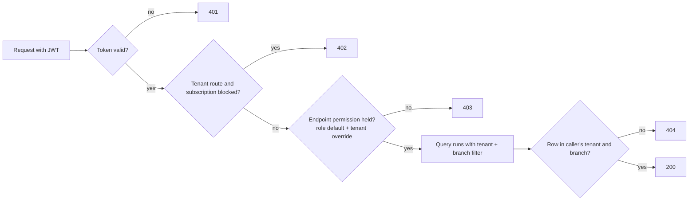

# Digital Darzi — Roles and Permissions

Phase 5. Verified against `Application/Common/Permissions.cs`, the `[HasPermission]` attributes on
every controller, and `SubscriptionMiddleware`. Companion: [SYSTEM_ANALYSIS.md](SYSTEM_ANALYSIS.md).

---

## 1. How access is decided



Four independent layers, all on the server:

1. **Authentication**: JWT signature, issuer, audience, lifetime.
2. **Subscription**: 402 for suspended, cancelled or expired shops. SystemAdmin is exempt.
3. **Permission**: each endpoint names one permission. A user holds it if any of their roles
   grants it by default or through the tenant's override table.
4. **Data isolation**: the database query filter. Even with a permission, a user cannot read
   another tenant's rows or another branch's operational rows. Records outside scope look like 404.

The client should hide what the user cannot do, using `GET /api/auth/me` → `permissions`, but must
still handle 403. Hiding is a convenience, never the control.

---

## 2. Roles

| Brief's role | Backend role | Scope | Sign-in |
|---|---|---|---|
| Super Admin | `SystemAdmin` | All tenants, platform routes only | Email + password |
| Shop Owner | `Owner` | Own tenant, all branches | Email + password, or phone + PIN |
| Shop Staff | `Manager` | Assigned branches | Either |
| Shop Staff | `Receptionist` | Assigned branches | Usually phone + PIN |
| Shop Staff | `Karigar` | Assigned branches, own work only | Phone + PIN |

A user can hold several roles. Their permissions are the union.

**Not modelled:** the designations the current app shows (Master, Cutter, Helper). See §6.

---

## 3. Permission matrix

✔ granted by default · ✎ off by default, Owner may grant · ✖ never (non-delegable or not applicable)

### Platform

| Capability | Endpoint group | SystemAdmin | Owner | Manager | Receptionist | Karigar |
|---|---|---|---|---|---|---|
| Provision owners, shops, subscriptions | `/api/admin/*` | ✔ role | ✖ | ✖ | ✖ | ✖ |
| Plans, tenant invoices, suspend/extend | `/api/admin/*` | ✔ role | ✖ | ✖ | ✖ | ✖ |
| View own subscription, plans, invoices | `billing.view` | ✖ | ✔ | ✖ | ✖ | ✖ |

### Shop administration

| Capability | Permission | SystemAdmin | Owner | Manager | Receptionist | Karigar |
|---|---|---|---|---|---|---|
| Create / delete branch | `shops.manage` | ✔ | ✔ | ✖ | ✖ | ✖ |
| Edit branch profile and settings | `shops.edit` | ✔ * | ✔ | ✔ | ✎ | ✎ |
| View staff | `users.view` | ✖ | ✔ | ✔ | ✎ | ✎ |
| Edit staff name, phone | `users.edit` | ✖ | ✔ | ✔ | ✎ | ✎ |
| Create, delete, deactivate staff; set roles and branches | `users.manage` | ✖ | ✔ | ✖ | ✖ | ✖ |
| Edit the role permission matrix | `settings.permissions` | ✖ | ✔ | ✖ | ✖ | ✖ |
| Audit log | `audit.view` | ✖ | ✔ | ✔ | ✎ | ✎ |
| Notification templates and sends | `notifications.manage` | ✖ | ✔ | ✔ | ✎ | ✎ |

\* SystemAdmin holds `shops.edit`, but `/api/shops` is tenant-filtered, so in practice it only
reaches its own HQ tenant.

### Customers and measurements

| Capability | Permission | Owner | Manager | Receptionist | Karigar |
|---|---|---|---|---|---|
| View customers | `customers.view` | ✔ | ✔ | ✔ | ✎ |
| Create / edit customers | `customers.edit` | ✔ | ✔ | ✔ | ✎ |
| Delete customers | `customers.delete` | ✔ | ✔ | ✎ | ✎ |
| Customer ledger | `finance.view` | ✔ | ✔ | ✎ | ✎ |
| View fields, templates, profiles, attributes | `measurements.view` | ✔ | ✔ | ✔ | ✔ |
| Create / edit customer profiles | `measurements.edit` | ✔ | ✔ | ✔ | ✎ |
| Configure fields, templates, attributes | `measurements.configure` | ✔ | ✔ | ✎ | ✎ |

### Orders and production

| Capability | Permission | Owner | Manager | Receptionist | Karigar |
|---|---|---|---|---|---|
| Open an order by id | `orders.view` | ✔ | ✔ | ✔ | ✔ any order (see R6) |
| List / search orders, boards | `orders.list` | ✔ | ✔ | ✔ | ✎ |
| Create, reorder | `orders.create` | ✔ | ✔ | ✎ | ✎ |
| Edit order header | `orders.edit` | ✔ | ✔ | ✎ | ✎ |
| Change status | `orders.status` | ✔ | ✔ | ✎ | ✎ |
| Cancel | `orders.cancel` | ✔ | ✔ | ✎ | ✎ |
| Deliver | `orders.deliver` | ✔ | ✔ | ✔ | ✎ |
| Deliver with balance owed | `orders.deliver_with_balance` | ✔ | ✔ | ✎ | ✎ |
| Trial result, alterations | `alterations.manage` | ✔ | ✔ | ✎ | ✎ |
| Assign karigars to stages | `production.assign` | ✔ | ✔ | ✎ | ✎ |
| Start / complete stages | `production.work` | ✔ | ✔ | ✎ | ✔ own assignments only (server-checked) |
| QC reject (rework) | `production.qc` | ✔ | ✔ | ✎ | ✎ |
| All karigars' queues, performance, workflow board | `karigar.view_all` | ✔ | ✔ | ✎ | ✎ |

Note the default **Receptionist cannot create orders**. If reception staff take orders at the
counter, the Owner must grant `orders.create` (decision in BUSINESS_WORKFLOWS §6).

### Money

| Capability | Permission | Owner | Manager | Receptionist | Karigar |
|---|---|---|---|---|---|
| Record payment | `payments.record` | ✔ | ✔ | ✔ | ✎ |
| Refund | `payments.refund` | ✔ | ✔ | ✎ | ✎ |
| Cash drawer | `cash.manage` | ✔ | ✔ | ✔ | ✎ |
| View finance, expenses, salaries | `finance.view` | ✔ | ✔ | ✎ | ✎ |
| Record expenses, salaries, attendance | `finance.manage` | ✔ | ✔ | ✎ | ✎ |
| Delete finance records | `finance.delete` | ✔ | ✎ | ✎ | ✎ |
| Karigar rates, ledger, payouts | `karigar.payouts` | ✔ | ✔ | ✎ | ✎ |
| Inventory view / manage | `inventory.view` / `inventory.manage` | ✔ / ✔ | ✔ / ✔ | ✔ / ✎ | ✎ / ✎ |

### Reports

| Capability | Permission | Owner | Manager | Receptionist | Karigar |
|---|---|---|---|---|---|
| Branch reports and dashboard | `reports.view` | ✔ | ✔ | ✎ | ✎ |
| All-branch reports (`scope=tenant`, `/reports/branches`) | `reports.tenant_wide` | ✔ | ✖ | ✖ | ✖ |

### Self-service (any signed-in staff)

`/api/auth/me`, change password or PIN, `/api/karigar/my-queue`, `my-completed`, `my-ledger`,
`/api/attendance/check-in`, `/api/attendance/my-attendance`.

---

## 4. Owner customisation

```http
GET /api/permissions            → role × permission matrix with defaults and current overrides
PUT /api/permissions/{role}     → { "permissions": [ ... ] }   role ∈ Manager, Receptionist, Karigar
```

Never delegable: `settings.permissions`, `users.manage`, `billing.view`, `shops.manage`,
`reports.tenant_wide`. Changes apply on the user's next request; the client should refetch
`/auth/me` on navigation or on any 403.

---

## 5. Page access for the redesigned app

Each page is shown when the user holds the listed permission. Buttons inside a page use the more
specific permission from §3.

| Area | Page | Required to show |
|---|---|---|
| Admin console | Platform dashboard, shops, owners, plans, invoices | role `SystemAdmin` |
| Shop | Dashboard | `reports.view`, else a simplified "my work" home |
| Shop | Orders, order detail | `orders.list` / `orders.view` |
| Shop | New order | `orders.create` |
| Shop | Delivery board | `orders.list` |
| Shop | Production board | `karigar.view_all` |
| Shop | My work (karigar) | `production.work` |
| Shop | Customers, customer detail | `customers.view` |
| Shop | Measurements setup (fields, templates, attributes) | `measurements.configure` |
| Shop | Payments and cash | `payments.record` or `cash.manage` |
| Shop | Finance, payroll, attendance | `finance.view` |
| Shop | Karigar pay | `karigar.payouts` |
| Shop | Inventory | `inventory.view` |
| Shop | Reports | `reports.view` |
| Shop | Staff | `users.view` |
| Shop | Roles and permissions | `settings.permissions` |
| Shop | Shop settings | `shops.edit` |
| Shop | Notifications | `notifications.manage` |
| Shop | Audit log | `audit.view` |
| Shop | Subscription and billing | `billing.view` |

A SystemAdmin token has no shop context worth using, so the admin console should be a separate
area that a SystemAdmin lands in after sign-in, and shop users never see.

---

## 6. Gaps and risks

| # | Issue | Impact | Options |
|---|---|---|---|
| R1 | App shows designations **Master, Cutter, Helper**; backend has only role `Karigar` | Owner cannot tell what permissions a "Helper" actually has. Filtering by designation has no backing data. | (a) Map all three to `Karigar` and drop the chips. (b) Add a `Designation` text field to users (small backend change) used for display and filtering only, permissions stay on roles. |
| R2 | Receptionist cannot create orders by default | Counter staff blocked | Owner grants `orders.create` from the permissions page, or change the default. |
| R3 | SystemAdmin cannot edit a tenant's shop profile | Admin must ask the owner to fix shop details | Add `PUT /api/admin/shops/{id}` that bypasses the tenant filter. |
| R4 | Plans have limits but no feature flags | "Control access to features based on plan" is not possible | Backend change: feature list on `SubscriptionPlan`, checked by middleware or permission handler. |
| R5 | Customer ledger needs `finance.view`, not `customers.view` | Receptionist sees customers but gets 403 on their balance history | Grant `finance.view`, or the UI shows balance from the order list instead. |
| R6 | A karigar with `orders.view` can open **any** order by id, including prices and customer phone. Only stage actions are restricted to their own assignments. | Information exposure inside the shop | Decide whether karigars should see prices. If not, backend change to trim the order detail for karigars. The karigar UI should use `my-queue` only. |
