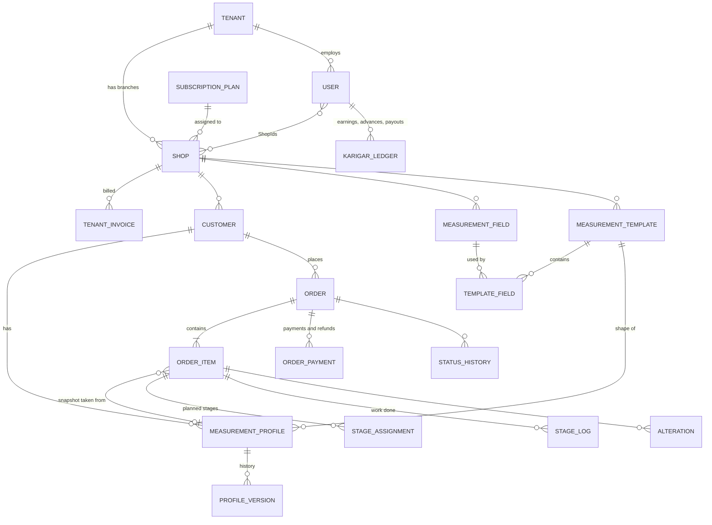

# Digital Darzi — System Analysis

Phase 1 of the UI/UX redesign. Analysis date: 2026-11-09. Branch `feature/roadmap-2026-09`.

Companion documents: [API_MAPPING.md](API_MAPPING.md), [ROLE_PERMISSIONS.md](ROLE_PERMISSIONS.md),
[BUSINESS_WORKFLOWS.md](BUSINESS_WORKFLOWS.md).

---

## 1. Scope and what was available

| Item | Status |
|---|---|
| Backend API source (`C:\work\DigitalDarziApi`) | Read in full for the areas below. Build passes, 145 unit tests pass. |
| Frontend source for the "Softronix tailors" app | **Not found on this machine.** Searched `C:\work`, the user profile and other drives. `C:\work\pos\mobile-shop-foundation` is an unrelated phone-shop POS (IMEI, products). |
| Running API and database | Not running at analysis time. PostgreSQL on `localhost:55432` was down, so no live calls were made. |
| Frontend evidence | Eight screenshots of the mobile app: dashboard, side menu, customers list, new customer, measurement template editor, create order step 3, orders list, staff management. |

Consequence: everything about the **backend** in these documents is verified against code.
Everything about the **current frontend** is inferred from screenshots only and is marked
*observed*. Framework, routing, state management and the exact API calls the app makes cannot be
determined until the frontend repository is available.

---

## 2. Backend architecture

| Layer | Project | Contents |
|---|---|---|
| Host | `API` | Controllers, permission policy provider, subscription middleware, validation filter, JSON converters, Serilog, health checks |
| Application | `Application` | Interfaces, ViewModels (the API contract), permission catalogue, order state machine, FluentValidation validators |
| Domain | `Domain` | Entities and enums, no dependencies |
| Infrastructure | `Infrastructure` | EF Core `ApplicationDbContext`, Identity, migrations, all services, notification outbox and background jobs |
| Data access | `Repositories` | Query repositories for shops, customers, measurements, orders, finance |

**Stack:** .NET 8, ASP.NET Core Web API, EF Core 8 with Npgsql (PostgreSQL), ASP.NET Identity + JWT,
FluentValidation, Serilog, Swashbuckle.

### 2.1 Tenancy model

- A **tenant** is one business (one owner). A tenant has one or more **shops** (branches).
- Every operational row carries `TenantId` and `BranchId`. The DbContext is built per request from
  the JWT claims `tenantId` and `shopId`, and global query filters restrict every read to
  *caller's tenant + caller's active branch + not deleted*.
- `Shop` and `User` rows are filtered by tenant only, so an owner sees all their branches.
- A user's `ShopIds` lists the branches they may switch to. `POST /api/auth/switch-branch` issues a
  new token for another branch.
- SystemAdmin services use `IgnoreQueryFilters()` to work across tenants. **The ordinary
  `/api/shops` routes do not**, so a SystemAdmin cannot edit another tenant's shop profile through
  them.

### 2.2 Authentication

- Email + password (Identity hasher) or phone + 4-digit PIN (BCrypt).
- Access token (JWT, 24 h default) plus single-use rotating refresh token (30 days).
- Lockout after repeated failures, 6-digit reset codes by SMS or email, sign-in rate limit 20/min/IP.
- `GET /api/auth/me` returns identity, active branch, switchable branches, **effective permission
  list**, currency, and subscription summary. It is the intended source for all client-side gating.

### 2.3 Authorization

- Five roles: `SystemAdmin`, `Owner`, `Manager`, `Receptionist`, `Karigar`.
- Endpoints require **named permissions** (39 of them), not roles. Each role has default grants,
  and an Owner may customise Manager, Receptionist and Karigar per tenant. Five permissions are
  Owner-only and never delegable. Details in [ROLE_PERMISSIONS.md](ROLE_PERMISSIONS.md).
- `/api/admin/*` requires the `SystemAdmin` role.

### 2.4 Subscription enforcement

- Each shop has `Status` (Trial, Active, Suspended, Cancelled), `TrialEndsAt`, `SubscriptionEndsAt`,
  plan name and plan id.
- Middleware returns **402** on every tenant route when the governing subscription is suspended,
  cancelled, or past its end date. `/api/auth`, `/api/billing`, `/api/admin`, health and Swagger
  stay reachable.
- Plans carry three **limits**, enforced on create: `MaxBranches`, `MaxUsers`, `MaxOrdersPerMonth`.
  Seeded plans: Starter (1 branch, 5 users, 300 orders, Rs 1,500), Growth (3, 20, 2,000, Rs 3,500),
  Business (unlimited, Rs 7,500). All have a 14-day trial.
- Plans do **not** carry feature flags. Every tenant gets every module.

---

## 3. Domain model

Other entities: `GarmentAttribute` (collar, cuff options per garment), `KarigarRate`, `ShopExpense`
and `ExpenseCategoryDefinition`, `StaffSalary`, `SalaryRule`, `SalaryAdvance`, `StaffAttendance`,
`InventoryItem`, `InventoryMovement`, `Supplier`, `CashSession`, `CashMovement`,
`NotificationTemplate`, `NotificationMessage`, `Attachment`, `AuditLog`, `RefreshToken`,
`PasswordResetCode`, `TenantRolePermission`.

---

## 4. Measurement architecture as built

This is the area the redesign cares most about, so it is described exactly.

| Concept | Entity | Owner can | Fields |
|---|---|---|---|
| Garment type | `GarmentType` **enum**, fixed in code | Nothing. Cannot add, rename or deactivate. | 1 ShalwarKameez, 2 Suit, 3 Sherwani, 4 Coat, 5 Trouser, 6 Shirt, 7 Frock, 8 Lehnga, 9 Kurta, 10 Waistcoat, 99 Other |
| Measurement field | `MeasurementField` (per shop) | Create, edit, delete | `name`, `unit` (Inch/CM/MM), `valueType` (Number/Text), `isRequired` default, `sortOrder` |
| Template | `MeasurementTemplate` (per shop) | Create, edit, delete. **No deactivate** in the update contract. | `name`, `description`, optional `garmentType`, `isDefault`, `displayOrder`, ordered fields with per-template `isRequired` override |
| Customer profile | `MeasurementProfile` | Create, edit, delete | customer, template, `profileName`, number values and text values keyed by field id, `notes`, `currentVersion` |
| Profile history | `MeasurementProfileVersion` | Read only | Every save writes a version. `GET /profiles/{id}/versions`. |
| Order snapshot | JSON on `OrderItem` | Read only | Frozen copy of template name, field names, units and values, plus profile id and version. Later profile edits never change past orders. |
| Garment attributes | `GarmentAttribute` (per shop) | Create, edit, delete, seed defaults | Name, option list or free text, optional garment type, required flag |

**Seeded for each new tenant:** 18 fields (Chest, Waist, Hip, Shoulder, Sleeve, Kameez Length,
Shirt Length, Collar, Trouser Length, Pant Length, Inseam, Pauncha, Coat Length, Cuff, Back Width,
Neck Depth, Bust, Frock Length) and 7 templates (Gents Shalwar Kameez, Gents Pant Coat, Sherwani,
Ladies Shalwar Kameez, Ladies Frock, Shirt Only, Trouser Only), plus attribute catalogues.

**Behaviour that matters for the order screen:**

1. A garment type can have **several templates** (Gents and Ladies Shalwar Kameez both map to
   type 1). A template's `garmentType` may also be null.
2. A customer can have **many profiles**, one or more per template. `GET
   /api/measurements/profiles/customer/{customerId}` returns all of them. Filtering by garment type
   is the client's job, using the template's `garmentType`.
3. Saving a profile **enforces required template fields** on the server.
4. An order item takes measurements from exactly one source: a saved `measurementProfileId`, or a
   `templateId` with inline values. Sending both is rejected.
5. **Inline order measurements are not saved back to the customer** and are **not checked against
   required fields**. To "enter new measurements and keep them", the client must first `POST
   /api/measurements/profiles`, then create the order with the returned profile id. These are two
   separate requests, not one transaction.

### Gaps against the requested measurement design

| Requested | Backend today | Gap |
|---|---|---|
| Owner-managed garment types with activate/deactivate | Fixed enum of 11 values | **Backend change** needed: a `GarmentType` table per shop, migration of every `garmentType` column, rates, attributes and reports. Large. |
| Field name **and** separate label | One `name` | Small backend change, or treat name as label. |
| Field types numeric, text, **dropdown** | Number and Text only | Backend change for dropdown options on a field. Garment attributes already cover dropdown-style choices per garment. |
| Required / optional | Field default plus per-template override | Supported. |
| Display order | `sortOrder` on field and template link | Supported. |
| Default value | Not stored | Backend change. |
| Deactivate a template | Delete only | Small backend change (`activeStatus` on update). |
| Multiple profiles per customer per garment | Supported | — |
| Version history | Supported, every save | — |
| Save new measurements during order creation | Two calls, client-orchestrated | Workable now. A `saveAsProfile` flag on the order item would make it atomic. |

---

## 5. Feature inventory

Status is from the backend's point of view. "Observed" is what the screenshots show of the app.

| Module | Backend | Observed in current app |
|---|---|---|
| Sign-in, refresh, branch switch, reset | Complete | Not shown |
| Session and permissions (`/auth/me`) | Complete | Not shown. Menu does not appear permission-aware. |
| SystemAdmin: provision owner, shop, subscription; plans; invoices; suspend/extend | Complete for provisioning and billing | Not shown. No admin UI seen. |
| SystemAdmin: platform dashboard, usage, platform settings | **Missing** | — |
| Shop profile and settings | Complete | Settings tab exists, content not shown |
| Staff CRUD, roles, branch access, deactivate | Complete | Staff list with role chips **Master, Cutter, Helper, Manager**. These designations do not exist in the backend. |
| Role permission matrix editing | Complete | Not shown |
| Customers CRUD, search, filters, ledger | Complete | List and create form. Form has **Alternate Phone**, which the backend does not have (it has WhatsApp number). |
| Measurement fields | Complete | Field list inside template editor |
| Measurement templates | Complete except deactivate | Template editor with garment type, display order, default, field checklist. **No per-field required toggle.** |
| Customer measurement profiles and versions | Complete | Only reachable after the customer is saved. Version history not seen. |
| Garment attributes | Complete | Not seen |
| Orders: create with multiple items | Complete | 4-step wizard, multiple items supported. Step 3 has garment chips, profile choice, price, qty, colour, style notes. **No inline measurement entry, no fabric source or charge, no attributes, no stage assignment.** |
| Order list, search, filters | Complete | List with tabs All, Active, Ready, Delivered and search |
| Order detail, status machine, history | Complete | Not shown |
| Payments, refunds, payment status | Complete | Not shown |
| Trial, alterations | Complete | Not shown |
| Delivery, partial delivery, cancel | Complete | Not shown |
| Delivery board | Complete | Dashboard shows a "Delayed: 8 orders" banner |
| Production: assign, start, complete, QC reject, kanban | Complete | Not shown |
| Karigar queue and ledger, piece rates | Complete | Not shown |
| Finance, payroll, attendance, cash drawer | Complete | Not in the menu |
| Inventory | Complete | Not in the menu |
| Notifications (WhatsApp/SMS) | Complete | Not in the menu |
| Reports and CSV export | Complete | Reports menu entry |
| Audit log | Complete | Not in the menu |
| Owner billing view | Complete | Not shown |

---

## 6. Problems seen in the screenshots

| Screen | Observation | Likely cause | Severity |
|---|---|---|---|
| Orders list | Orders show **"0 item"** with a non-zero total | The app may read item count from a field the list does not return (the list returns `itemCount`, not `items`), or these are orders created before the server began requiring at least one item | High: misleads staff |
| Orders list | One order shows **"Pending"** | Status `0` is a legacy value the API no longer sets. Old data, or the app maps an unknown value to Pending | Medium |
| Orders list | Tabs All / Active / Ready / Delivered only | No Overdue, Trial or Due-today view, though the API offers them | Medium |
| Dashboard | **"+12%"** next to Total Clients | No API field returns a percentage change. Likely hard-coded | Medium: fake data |
| Dashboard | "Rs 0 Daily revenue" with 8 active orders | May be correct. Cannot verify without the app code | Low |
| Staff | Role chips Master / Cutter / Helper, every person tagged HELPER | Backend roles are Owner, Manager, Receptionist, Karigar. The designation is stored somewhere the API does not model, or is hard-coded | High: role confusion and possible wrong permissions |
| Staff | Several "Nnnn" users | Test data in the shop | Low |
| Create order step 3 | Garment chips include "Pant Coat" | Probably template names shown as garment types. Mixing the two concepts | Medium |
| Create order step 3 | Profile choice "Overcoat" shown under Shalwar Kameez | Profiles not filtered by the selected garment | High: wrong measurements on the order |
| Create order step 3 | No way to type measurements during the order | The order flow depends on a profile existing first | High |
| New customer | "Alternate Phone" field | Not in the API. The value is likely dropped | Medium |
| New customer | No gender, city, customer type | API supports them | Low |
| Templates | Only a checkbox per field | Per-template required flag and order are not editable | Medium |
| Global | Dark header on dashboard and templates, light header elsewhere | No shared layout component | Low |

---

## 7. What is needed to continue

1. **The frontend repository** (path or git URL). Phases 6 to 8 modify that codebase and cannot
   start without it.
2. Confirmation of the **target platform**: the screenshots are a phone app, the redesign brief
   describes a sidebar SaaS web app. Both are possible on this API.
3. Decisions listed in [BUSINESS_WORKFLOWS.md §6](BUSINESS_WORKFLOWS.md#6-decisions-that-need-your-approval).
